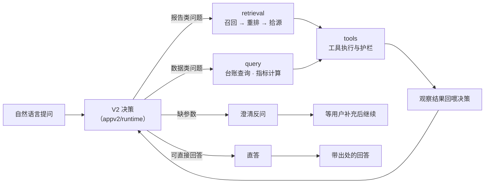
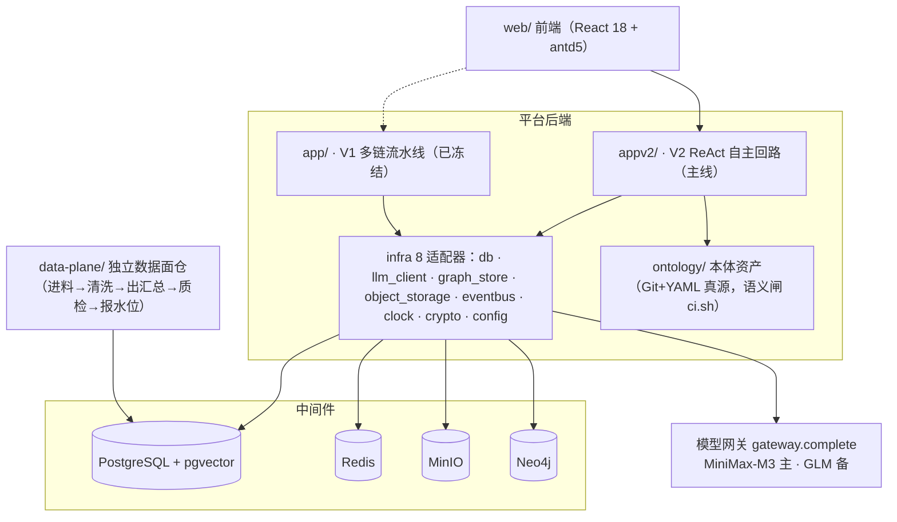
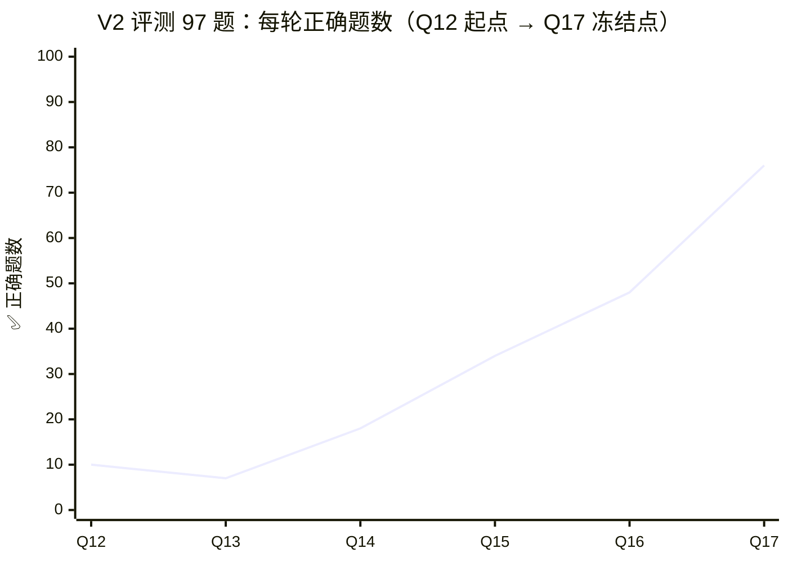

# Petro-Agent 平台（真实实现仓）

面向油气田生产场景的智能问答平台：**问报告**（知识检索问答，回答带原文出处）、**问数据**（自然语言查台账，Text2SQL 与指标计算）、**问智**（把答案加工成汇报成品）。平台由 ReAct 自主回路驱动（V2），模型调用走统一网关。97 题标准题册多轮实测：正确题数从重写起点的 10 爬到冻结点 **76/97**。

     

## 项目地图（同一项目的各部分 GitHub 仓）

本项目按「设计真源 → 平台实现 → 数据面 → 合成数据」分仓协作，各仓独立 git，GitHub 平级发布：

| 仓库 | 角色 | 可见性 |
|---|---|---|
| **本仓** [petro-agent-platform](https://github.com/zzwcoding/petro-agent-platform) | 平台实现仓：后端 `app/`＋`appv2/` · 前端 `web/` · 本体 `ontology/`（已并入） | 公开 |
| [teach-petro-agent-public](https://github.com/zzwcoding/teach-petro-agent-public) | 设计/教学真源仓：合同册 specs/api · ADR 链 · 业务设定 · 架构大图 · 前端原型 | 公开 |
| [tpa-data-plane](https://github.com/zzwcoding/tpa-data-plane) | 数据面仓：独立数据服务（进料→清洗→出汇总→质检→报水位） | 公开 |
| [fieldforge](https://github.com/zzwcoding/fieldforge) | 油气领域合成数据生成工作台 | 公开 |

## 平台能做什么

技术团队用自然语言问平台三件事：

- **问报告**——「N-2 井的完井方式是什么」：检索报告库并回答，答案必须带原文出处，检索不到就明说没有，不许编。
- **问数据**——「上个月产量最高的三口井」：把问题翻译成台账查询与指标计算，数字必须与台账对得上，口径要交代。
- **问智**——「做成汇报材料配图表」：把前两者的结果加工成报告成品（文档/图表）。

三条能力共享同一套知识资产：报告库、常见问题库、语义台账（本体资产驱动口径统一）、关系图谱，底层由数据面仓持续供给经过质检的数据。

## 功能架构



一次提问的完整闭环：模型在运行时里自主决策「走检索 / 查台账 / 反问澄清 / 直接回答」，每步执行结果回喂给下一步决策，直到给出带出处的回答。决策不是裸奔的，外面有一圈**确定性护栏**：同参重投拦截（同一载荷二次发射直接拦，拒因回喂模型重决策）、数据新鲜度闸、审批重投通道、工具重试预算、轮数预算收敛——全部是代码闸，不依赖模型自觉。

### 功能概览

| 面 | 内容 |
|---|---|
| **V1 后端 `app/`**（已冻结） | 接口层 11 路由族：security 身份 · gateway 模型网关 · chat 对话 · semantics 语义台账 · kb 报告库 · wiki 报告百科 · graph 关系图谱 · faq 常见问题库 · retrieval 检索 · wells 井档案 · quality 质量。问答侧是多链流水线：检索问答链 · 状态机六站链 · FAQ 直出 · 图谱链 |
| **V2 后端 `appv2/`**（主线） | 重写为 ReAct 自主回路：模型自主决策「检索 / 查数 / 反问 / 直答」，六个包分职——retrieval 检索 · runtime 运行时 · query 问数 · knowledge 知识 · tools 工具层 · api 接口 |
| **前端 `web/`** | React 18 + antd5 + AntV G6，页面族 A（对话）· B（报告库/百科/图谱/FAQ）· C（台账/语义）· D（数据面观测），Vite 构建、Vitest 测试 |
| **本体 `ontology/`** | 平台仓普通目录：本体资产 Git+YAML 真源，改动过语义闸 `bash ontology/ci.sh` |
| **数据面 `data-plane/`** | 嵌套独立仓：进料→清洗→出汇总→质检→报水位，纪律见其 AGENTS.md |
| **评测 `eval/`** | 97 题门禁题册 gold-v1 · 判分总则 · 全部轮次报告与逐题判分证据（SSE 帧） |

## 系统架构一图



四层架构（接口层 / 领域层 / 基础设施层 / 资产层）层间依赖单向向下，边界规则逐条进 `import-linter` 机检。

## 文件架构

```
petro-agent-platform/
├── app/                  # V1 后端（已冻结）——四层架构
│   ├── api/              #   接口层：路由薄壳（11 路由族，唯一框架接触面）
│   ├── domains/          #   领域层：14 模块（kb 报告库 · semantics 语义台账 · derivatives 百科/图谱 ·
│   │                     #     faq · wells 井档案 · retrieval · gateway · security · chat ·
│   │                     #     approval · assessment · dataops · expose · governance）
│   ├── infra/            #   基础设施层：8 适配器（db · llm_client · graph_store · object_storage ·
│   │                     #     eventbus · clock · crypto · config；queue/sse_channel/scheduler 预留）
│   └── main.py           #   V1 入口（:8000）
├── appv2/                # V2 后端（主线）——ReAct 自主回路
│   ├── runtime/          #   运行时：循环编排 + 护栏（executor · graph · state · budget 预算 ·
│   │                     #     checkpointer 断点 · blackbox 黑匣子观测 · eval_clock 评测时钟 · audit 审计）
│   ├── retrieval/        #   检索：embedder 向量化 · engine 引擎 · enrich 拾源（PG 实装 + 假件双轨）
│   ├── query/            #   问数：engine · executor 台账执行 · pg_waterline 水位 · pg_wells 井档案
│   ├── knowledge/        #   知识：报告库/FAQ 存储（pg_store · pg_faq · snapshot）
│   ├── tools/            #   工具层：registry 注册表 · handlers · precondition 前置闸 · argscheck 参检 ·
│   │                     #     anchors 锚点 · ledger 台账工具
│   ├── api/              #   接口：app.py（Petro-Agent V2）· chat SSE 对话流
│   └── infra/            #   V2 基础设施
├── web/                  # 前端：React18 + antd5（pages 页面族 A/B/C/D · flows 流程 · landing 落地页 · store 状态）
├── ontology/             # 本体资产（Git+YAML 真源；ci.sh 语义闸＝98 单测+出厂集）
├── data-plane/           # 数据面（嵌套独立 git 仓，.gitignore 排除）
├── eval/                 # 评测：gold-v1 门禁题册（97 题） · reports 报告 · results（HTML 报告 + frames 逐题帧）
├── tickets/              # 施工票：一票一分支一提交（phase1/phase3/v2 分册）
├── dispatch/             # 双窗口调度运行态（PROTOCOL.md 协议本体进 git）
├── config/               # models.yaml 模型别名 · database.yaml · contract_endpoints.json 合同清单
│                         #   entity_types.json / relation_types.json 本体类型注册
├── specs/                # V2 模块规格快照（agent-loop · retrieval · query · knowledge · infra · modules）
├── tools/                # 机器闸：contract_coverage 合同覆盖率 · debt_markers 债务标记 · check_specs 规格
│                         #   ticket_close_check 关票 · run_replay 复跑 · prototype_guard 原型
├── tests/                # pytest 全量（1600+ 用例）
├── migrations/           # 数据库迁移（alembic）
├── deploy/cloud/         # 云部署：backend.Dockerfile · compose.yml · nginx-tpa.conf
├── scripts/              # 部署脚本（compose-up / restore-data / app-install / smoke）
├── docs/                 # architecture-v2 · deploy runbook · 本体应用讲解
└── README.md             # 本文件
```

## 组织架构（仓间分工与施工流）

**四仓分工**：设计真源在 teach-petro-agent-public（API 合同册/模块划分/数据库设计/ADR 链），本仓只放实现代码并**引用**真源路径（合同正文不复制进来）；数据面独立仓独立提交节奏；fieldforge 产出合成数据经数据面进料。

**施工流**（本仓的开发方式）：

```
合同册端点 → 拆施工票（合同册端点闭世界全量分派，不留白）
  → 一票一分支一提交 → 验收（票面对象全勾才合）
  → 两道机器闸把守交付：contract_coverage（合同 × 路由双向对账）
     debt_markers（债务短语必须携去向标签）＋ CI 五闸（lint/类型/测试/边界/合同）
```

每张票的施工、验收、判分过程都留档在 `tickets/` 与 `eval/`，可回溯每一行代码的来历。

## 技术选型

| 层 | 选型 | 在项目中的角色 |
|---|---|---|
| 运行时 | Python 3.12 + uv | 后端语言与依赖管理（uv.lock 锁版本） |
| Web 框架 | FastAPI | 接口层薄壳与 SSE 流式输出（对话帧逐 token 推送） |
| 数据访问 | SQLAlchemy 2 (asyncio) + asyncpg | 异步数据库访问，唯一出口 `infra.db`（B3 边界） |
| 迁移 | Alembic | `migrations/` 版本化建库 |
| Agent 编排 | LangGraph | V2 ReAct 回路的图编排（`appv2/runtime`） |
| 模型接入 | LiteLLM | 多供应商适配，统一出口 `gateway.complete`（B6 边界），别名制路由主备模型 |
| 向量检索 | PostgreSQL + pgvector | RAG 向量存储与召回（报告库/FAQ 检索） |
| 图数据库 | Neo4j | 关系图谱（B5 图谱面） |
| 对象存储 | MinIO | 报告/文件存储 |
| 缓存 | Redis | 会话与运行态缓存 |
| 定时任务 | APScheduler | 数据面联动与周期任务调度 |
| 字段加密 | gmssl（SM4） | `infra.crypto` EncryptedField 敏感字段加密 |
| 前端框架 | React 18 + antd5 | `web/` 全部界面 |
| 图可视化 | AntV G6 | 关系图谱渲染 |
| 前端状态 | zustand | 轻量状态管理 |
| 构建 | Vite | 前端构建与开发服 |
| 前端测试 | Vitest | web 组件测试 |
| 质量闸 | pytest · ruff · mypy · import-linter | 测试（1600+）/lint/类型/边界合同四闸，加合同覆盖率与债务标记两道交付闸 |

## 双版本演进与评测曲线

97 题门禁题册（`eval/gold-v1/`）贯穿两代实现，**同一把尺量到底**。判分三级：✅ 正确且有据 · ⚠️ 部分正确 · ❌ 错误/编造/应拒未拒。反题铁律：报告里没有的数，给数就是错，说没有才算过。



**六轮明细**（每轮暴露的问题 → 下一轮修复）：

| 轮次 | 日期 | 成绩 | 该轮焦点 |
|---|---|---|---|
| Q12 首轮大考 | 10-09 | 10✅ 39⚠️ 48❌ | 报告题全被送进台账查数，翻报告的路零使用 |
| Q13 | 10-10 | 7✅ 44⚠️ 46❌ | 选了检索却执行不了：工具匹配缺字段被拒、反问卡挂起 30 题 |
| Q14 | 10-10 | 18✅ 49⚠️ 30❌ | 答案漏出程序格式 JSON（6 题）；召回 50 条只送 4 条 |
| Q15 | 10-11 | 34✅ 34⚠️ 29❌ | 料在窗口里却说没料（零交付族 22 题）；错答与新增对冲 |
| Q16 | 10-12 | 48✅ 44⚠️ 5❌ | 只剩两大新形态：错域锚定 3＋无据调和 2；毕业线差一道贴线 |
| Q17 冻结点 | 10-13 | 76✅ 19⚠️ 2❌ | 错域锚定族清零、无据调和全转对；仅存两题「首跑错值、后轮自纠」——毕业线首次达标 |

**Q17 冻结点的七个测试维度**：

| 维度 | 考什么 | Q17 结果 |
|---|---|---|
| 一 · 正题 | 报告里写了的，答得对吗 | 问答组 A＋B：13✅ 6⚠️ 2❌；C＋D：22✅ 3⚠️ 0❌ |
| 二 · 反题 | 报告里没有的，会不会瞎编 | 无据调和 2 道全转正确（明说没有＋指向正确数据域） |
| 三 · 检索 | 东西在库里，递得到 AI 眼前吗 | 问题块抢席位问题定位并修复（V2-65） |
| 四 · 多文档判源 | 库里多份像的材料，引对了吗 | 错域锚定族清零 |
| 五 · 问数 | 台账里的数查得对、算得对吗 | 19✅ 2⚠️ 0❌ |
| 六 · 系统级 | 安全闸和体验规矩守不守 | 0 错 |
| 七 · 新语料三册 | 材料本身有毛病，怎么办 | 22✅ 8⚠️ 0❌ |

**评测方法论**（让 76 分可信的东西）：

- 同卷同尺：Q12→Q17 全部跑同一份 97 题，跨轮可比；判分总则四轮演进全部留档（`eval/README.md`）。
- 测评时钟冻结：评测面系统时间冻结在水位日 2026-08-31，生产时钟不动——时间类问题零歧义。
- 金钉值抽查：跨轮核对固定锚点答案（如 Z-16=5839.63、N-15=8824.36），尺子漂移即红。
- 全留痕：每题的完整对话帧（SSE）与跑批结果落 `eval/results/`，判分可回放、可复核。
- 详细报告：**[V1 版本测试报告](eval/results/V1版本测试报告.html)**（V1 冻结成绩单 Q11：✅52 ⚠️35 ❌10）· **[V2 版本测试报告](eval/results/V2版本测试报告.html)**（六轮曲线到 Q17）· **[题集测试轮次台账](eval/results/题集测试轮次台账.md)**（35 个病根族的问题/措施/前后对比）。

## 快速开始

```bash
git clone https://github.com/zzwcoding/petro-agent-platform.git
cd petro-agent-platform
cp .env.example .env                          # 填入 LLM 凭证（MINIMAX_API_KEY 等）
uv sync                                       # 后端依赖（Python 3.12 由 uv 管理）
docker compose up -d                          # 中间件：PG(+pgvector)/Redis/MinIO/Neo4j（Langfuse 见 observe profile）
uv run uvicorn app.main:app --reload          # V1 后端 :8000
uv run uvicorn appv2.api.app:app --reload     # V2 后端（Petro-Agent V2）
cd web && npm install && npm run dev          # 前端（Vite）
```

数据面为独立仓：`git clone https://github.com/zzwcoding/tpa-data-plane.git`。备份：平台仓＋数据面仓两仓即全量（本体已并入平台仓）；本地整个文件夹拷走也可（两份 `.git` 全在内）。

## 模型注册表（调用别名制）

`config/models.yaml` 进 git（只记别名不记密钥，密钥经 `.env` 注入）。当前：主模型 **MiniMax-M3**（petro-main）、备用/降级 **glm-5.3-flash**（petro-lite），双端点均为 Anthropic 兼容协议（2026-09-29 curl 实测通过，调用形状见文件头注释）。价格已裁决：两模型统一 百万输入 1 元/百万输出 3 元（prices.default）。向量化 **embo-01**（petro-embed，2026-10-02 选型接线）——`/v1/embeddings`· 1536 维已归一化，kb/faq 专用、只经 `infra.llm_client.embeddings`（非 gateway.complete 面）；价格档 0.0005 元/千 token（历史定价页，以账单为准）。

## 结构纪律（98 册四层 + B1–B16 边界规则）

```
app/api/       接口层：9 个路由族薄壳（全量按阶段点亮），只调 domains 公开接口（B2），唯一框架接触面
app/domains/   14 模块（3 组）：service.py 薄 + domain.py 厚；模块间只走公开接口+领域事件（B11）
app/infra/     8 在 3 预留 adapter：db/graph_store/object_storage/eventbus/clock/crypto/
               config/llm_client 在，queue/sse_channel/scheduler 预留——唯一经允许的底层接触面（B3/B6）
ontology/      平台仓目录：本体资产（Git+YAML 真源，all-agent 纪律；改动前跑 bash ontology/ci.sh）
data-plane/    独立仓：数据面服务（进料→清洗→出汇总→质检→报水位，纪律见其 AGENTS.md）
```

层间依赖单向向下（B16），边界规则逐条进 `import-linter`（见 pyproject），CI 五闸：lint/类型/测试/边界闸/合同覆盖率闸（`tools/contract_coverage.py`——合同册端点 × 实现路由双向对账）＋债务标记闸（`tools/debt_markers.py`）——**两道机器闸是交付闸，红即不过**（AGENTS.md 硬纪律 8）。

## 嵌套仓纪律（data-plane）

1. data-plane 内容**回 data-plane 仓提交推送**（cd data-plane && git commit…，远程 https://github.com/zzwcoding/tpa-data-plane），平台仓 .gitignore 排除之，不记版本；
2. 改动守 data-plane 仓自己的 AGENTS.md（ADR 链）；
3. ontology/ 已并入平台仓普通目录（2026-09-30 子树合并，历史随合并提交可溯）——本体改动直接提交本仓，提交前跑 `bash ontology/ci.sh` 语义闸。

## 开发期身份

`X-Dev-User` 请求头＝身份桩（OAuth2.0 预留切换，时点未拍板——ADR-0003）。生产前所有端点默认信任此头。

## 双库纪律

开发 PostgreSQL / 生产数据库——SQL 一律经 `infra.db` 连接层（B3），方言切换唯一缝；禁止裸驱动（psycopg/asyncpg）散落业务代码。

## 文档指引

| 想看什么 | 去哪 |
|---|---|
| API 合同 / 模块划分 / 数据库设计（设计真源，不复制进本仓） | [teach-petro-agent-public/specs/](https://github.com/zzwcoding/teach-petro-agent-public) |
| 架构大图 · ADR 链 · 业务设定 · 阶段规划 | teach-petro-agent-public `docs/` 与 `diagrams/` |
| V2 架构说明 | 本仓 [docs/architecture-v2.md](docs/architecture-v2.md) |
| 评测全部轮次报告与判分证据 | 本仓 `eval/results/`（两份 HTML 报告见上） |
| 施工过程（一票一分支一提交） | 本仓 `tickets/` · `dispatch/` |
| 数据库账号与运维 runbook | 本仓 docs/deploy/ |
