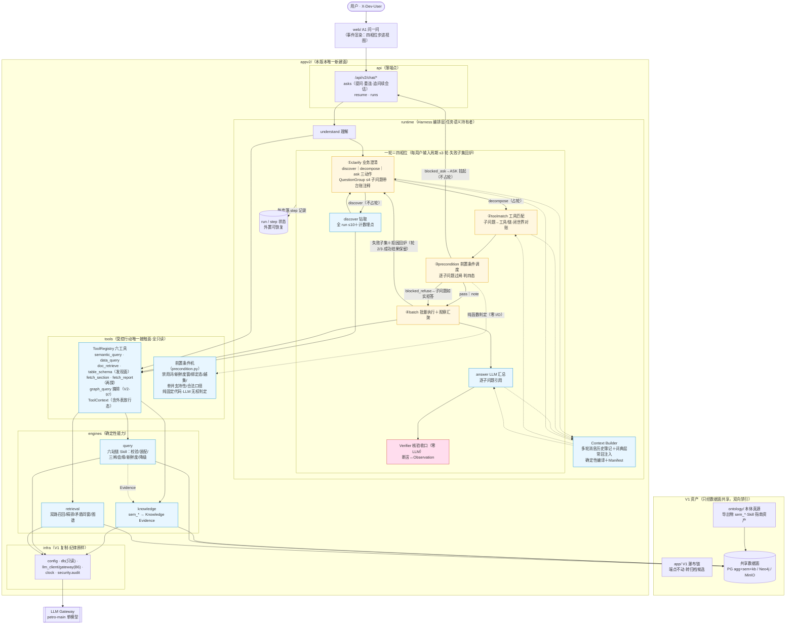

# 架构图 · Petro Data Agent V2

> 阶段 2 产物。图＝specs/modules.md 的可视投影；卡为准，图为导览。
> 审图纪律：用户逐节点过图，决策当场落盘；过审记 ADR。
> V2-36 终态重画（2026-10-09）：ReAct 自主循环（ADR-0004）⇄ 一轮＝四相位子任务图
> （ADR-0005）＋多轮对话上下文（ADR-0006）——取代前版六节点流水线图。

## 节点说明（导览用）

1. **用户→web→api**：身份桩进 resolve_actor；api 薄，不持有编排语义。
   asks 入参三形态——question 提问／resume_run_id 断线重连／question＋followup_run_id
   追问续会话（前轮消息历史随追问进新 run——ADR-0006 会话线程承接）。
2. **runtime 四相位循环**（ADR-0005 终态）：一轮＝①业务澄清（LLM 带 Skill 指南发射
   discover｜decompose｜ask——discover 钻取不占轮，decompose 产出 QuestionGroup 问题组，
   子问题 ≤4 且必带台账注释）→②工具匹配（子问题→工具/链，与问题组闭世界对账）→
   ③前置条件机逐子问题过闸判四态→④批量执行＋LLM 汇总。每用户输入周期 ≤3 轮——
   轮 2/3 只带失败/缺失子问题＋拒因回炉①，成功子问题结果保留不重跑；ASK 挂起不占轮。
   **发射判据**（治数据路径退化）：窗可锚定＝禁 ask；台账命中＋窗已定＝禁再 discover；
   ask 仅限阈值判断形反问与真歧义两白场。
3. **Context Builder**：模型每轮所见经确定性编译——多轮消息历史簿记（调用/输出/工具
   参数与结果/闸拒拒因全进史，负信息不消失——ADR-0006）＋词典层常驻注入（台账全量＋
   别名＋结构卡，每轮在场不重复入史）＋Manifest（来源/版本/信任级/token——Q11 "判断
   依据里没有本体"的根治点）。
4. **前置条件机落位**：闸件本体＝`tools/precondition.py` 纯固定代码（禁用词/新鲜度窗/
   在册绑定态/外表越集/单井支持性/合法口径 caliber_key 三态），runtime 前置相位逐子
   问题消费——**铁律：LLM 出语义（澄清/分解/提议），代码出判定（前置条件机零 LLM）**。
   四态：pass｜blocked_ask→ASK 挂起（外表审批/口径反问）｜blocked_refuse→子问题如实
   拒答｜note 注记随行。外表放行态落 ToolContext.approved_tables（A2 裁决）。
5. **tools**：agent 与世界的唯一接触面（书 6.1 受控行动链的工具侧）：六工具——三个
   能力工具（semantic_query/data_query/doc_retrieve）＋table_schema 结构卡发现面（agg 三表
   ＋sem 五账＋kb 片段清单，白名单外湖表不开放）＋fetch_section/fetch_report（V2-96 作答侧
   再探的按来源读面，只读、截断＋披露）；`graph_query` 已从注册面摘除
   （V2-97／D7——生产装配无 `graph=`，handler/常量/GraphSource/compound 件保留，恢复
   条件见 `specs/tools.md` 摘除注记）；参数 schema 校验、只读声明、错误三分类、ASK 帧。
   INV-2 在此机器化。
   discover 全 run ≤10＋每次计数埋点（次数/查询词/命中形态）落 step payload 供分析。
6. **knowledge**：本体利用率的主战场——sem_* 台账读成 Evidence（含绑定状态/届满），
   别名投影、族标注全要素进 agent 语境；词典层第 1 轮即全量进上下文（注入胜检索，
   semantic_query 转钻取）。
7. **query**：V1 六站链原样移植为 Skill——三闸、新鲜度改绑、未绑定降级、缺参反问、
   越集审批全保留；输出权威表＋血缘卡。
8. **retrieval**：双路召回＋精排；供给策略本体化——**矛盾来源同窗并立**、截断显式
   （"召回 N/送窗 M"写进 window_note，治 Q11 的"材料未披露"虚答）。
9. **Verifier**：交付前核验收口——每个断言必须有 Observation 支撑，无支撑→如实
   "未找到"。这是 INV-1/INV-4 在 loop 侧的落点；citation fail-closed 校验（确定性）
   在引擎侧不动。
10. **infra**：V1 复制层，B6 单出口/只读/审计纪律原样——appv2 不引入第二条 LLM 通路。
11. **共享边界**：V1↔V2 双向禁引；ontology 经导出物入数据面（Skill 指南同为 ontology
    资产——与台账同治理）；web 只走 /api/v2 HTTP。
