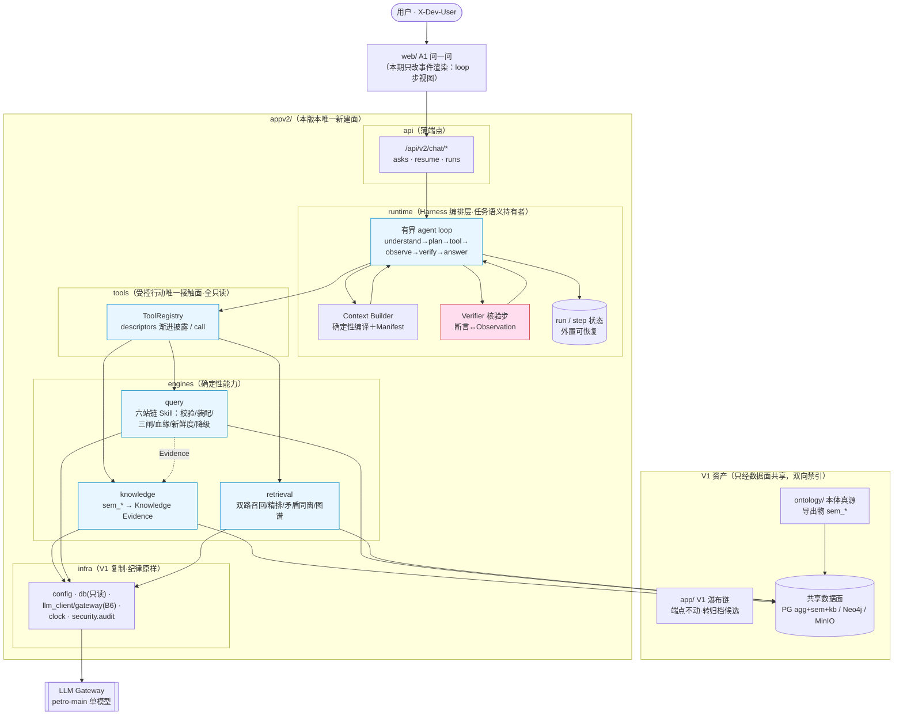

# 架构图 · Petro Data Agent V2

> 阶段 2 产物。图＝specs/modules.md 的可视投影；卡为准，图为导览。
> 审图纪律：用户逐节点过图，决策当场落盘；过审记 ADR。

## 节点说明（导览用）

1. **用户→web→api**：身份桩进 resolve_actor；api 薄，不持有编排语义。
2. **runtime**：唯一的"任务语义持有者"。loop 每步落 step；模型每轮所见经 Context Builder
   确定性编译并生成 Manifest（来源/版本/信任级/token——Q11 "判断依据里没有本体"的根治点）。
3. **tools**：agent 与世界的唯一接触面（书 6.1 受控行动链的工具侧）：参数 schema 校验、
   只读声明、错误分类（可重试|修参|拒答）、ASK 帧。INV-2 在此机器化。
4. **knowledge**：本体利用率的主战场——sem_* 台账读成 Evidence（含绑定状态/届满），
   别名八键、族标注全要素进 agent 语境。
5. **query**：V1 六站链原样移植为 Skill——三闸、新鲜度改绑、未绑定降级、缺参反问、
   越集审批全保留；输出权威表＋血缘卡。
6. **retrieval**：双路召回＋精排；供给策略本体化——**矛盾来源同窗并立**、截断显式
   （"召回 N/送窗 M"写进 window_note，治 Q11 的"材料未披露"虚答）。
7. **Verifier**：交付前核验步——每个断言必须有 Observation 支撑，无支撑→如实"未找到"。
   这是 INV-1/INV-4 在 loop 侧的落点；citation fail-closed 校验（确定性）在引擎侧不动。
8. **infra**：V1 复制层，B6 单出口/只读/审计纪律原样——appv2 不引入第二条 LLM 通路。
9. **共享边界**：V1↔V2 双向禁引；ontology 经导出物入数据面；web 只走 /api/v2 HTTP。
