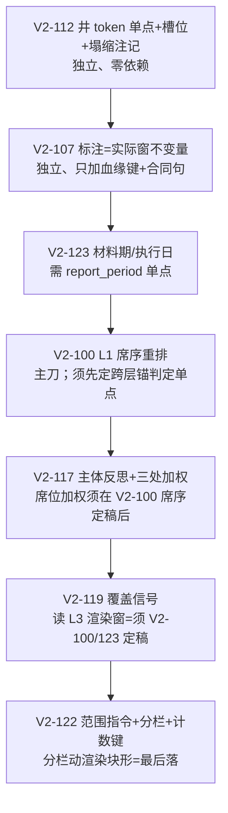

# 统筹方案 · 供给/窗口/材料组（25 票统一实施方案设计）

> 性质：**设计件，非施工**。只读代码取证；产物只落本文件。凡标「需 L0 裁」＝本设计不自行裁量。
> 覆盖票（本组实施 7）：**V2-100／107／112／117／119／122／123**；交互票（已 done，只做耦合分析 4）：**V2-89b／93／90／86**。
> 真源：`docs/runtime-refactor/接手-召回全链路最终决议与运行流程-20261018.md`（下称《流程》§一/§二/§四/§十二 D9）＋
> `接手-EB11全量147题修复方案-20261018.md`（下称《EB11方案》§三 P1/§五）＋`接手-逻辑层方案与统筹清单-20261018.md`（下称《清单》§三 L1–L6/§四/§五）。
> 层名一律按《流程》§一：L0 召回池→L1 供给窗（`retrieval/domain.py::supply_window`）→L2 并集池（编排合并）→L3 渲染窗（`context/materials.py::_select_seats`）→L4 作答→L5 核验。
> **票面缺失声明**：`tickets/v2/` 下**无** V2-100／107／112 票面文件（三者仅在《清单》§四「已在案」行、《EB11方案》§三 P1 行、《流程》§十二 D9 在案）。
> 本文件对该三票的「施工基准」为上述三处**逐条转写**，不自行发明语义；是否补票面见 §六-1。
> 施工纪律：一票一提交；additive 优先；不动已验收面（披露行／三机检字段／`selected_reason` 逐字、反题红线、四层边界规则）；单点真源禁第二份副本。

## 一、现状路径与改动插入点（L0→L1→L2→L3→L4）

| 票 | 层 | 现状落点（file:line） | 现状数据流／现状行为 | 本票插入点 |
|---|---|---|---|---|
| **V2-100** | L1 | `retrieval/domain.py::supply_window:616`：族配额 `:688-701`→锚保底 `:703-727`→行集 `:729-757`→节内展开 `:759-762`→余量 `:766-772`；来源级去重 `seated_reports:709,719`；`anchor_seat_tokens:591`；`source_diversify:487`；`SECTION_EXPAND_CAP:484` | 配额先吃干预算⇒锚/行集/展开无余量（EB10 20/20 `anchor_seated=0`）；同源摘要已占席⇒同源原文切片不补（D9） | 重排 `supply_window` 席序：题眼锚/表格/原文候选**先占预算**，族配额其次；去重粒度「来源级」→「片段级」 |
| **V2-100** | L3 | `context/materials.py::_select_seats:329`（⓪声明 `:367`／①题眼 `:393-418`／②原文 `:419-430`／③表格 `:431-441`／④锚共现 `:442-451`／⑤来源 `:452-457`／⑥轮转 `:458-470`） | ②已保证「摘要不得顶替同源原文」 | **零改**（V2-93 已覆盖 L3 半面）；只补 L1 半面 |
| **V2-107** | L4 | `query/domain.py::parse_time_window:207`／`TimeWindow:197`（`label` 单点）；`LINEAGE_KEY_FILTER:99`；`handlers._rows_observations:1052-1079`（血缘 payload） | 实际取数窗已在血缘③；答案日期标注由模型自由书写（数-闸2 自书「近 7 天（截至 2026-08-31）」、数-闸3 标注被核验删） | 血缘 payload additive 键 `window_label`＋合同句「标注＝取数窗」＋核验机检（只标红不删句） |
| **V2-112** | L2/闸 | `tools/precondition.py::_WELL_RE:93`＝`\b[A-Z]{1,3}-\d{1,4}\b`；闸 6 `:623-629`；`query/domain.py::QueryPlan:310-333` **无井槽位**；`handlers._rows_observations:1028-1040`（整窗合计行 `window_total`） | **根因（本设计新证）**：`\b` 把中文当 `\w` ⇒ `N-01和Z-16比` 的 `findall=[]` ⇒ 闸 6 静默。Q40 帧 `前置条件机：s1=allow` 且无 `decision_note`（对照 Q10/Q24/Q47 均有）；Q40 塌缩为「整窗合计·全井 70647.29」 | 井 token 单点换 `tools/anchors.py::WELL_TOKEN_RE:37`（已带正确边界）；`QueryPlan` additive `well_slot`；塌缩位 `locator.well_collapsed`＋强制注记 |
| **V2-117** | L2→L1/L3/L5 | `state/models.py::RunState.subjects:215`／`terms:216`；`clarification/subject_ask.py:85-112`（只抽取）；`engine._reorder_by_source_confidence:611`；`answering.answer_anchors:305`→`materials._anchor_score:269`；`verification/rules.py::field_attribution_mismatch:614`（只油田粒度）；L2 落点 `execution/core.py:1178`（`state.observations.append`） | 抽取后**无反思**；三处下游零主体权重；件四全拒⇒零交付 | L2 并集后跑 `reflect_subjects`；结果以**参数**（非 state 直读）喂 retrieval 排序／L3 席位／核验归属 |
| **V2-119** | L3→L4 | `answering/core.py::_draft:338`（`render_materials:358`→`append_message:374-382`）；`degradation.engine_notes_block:374`；`_draft_gaps:725` | 程序可算「子问题→窗内有无支撑」但未算、未给模型 ⇒ `explore` 0/147 | `_draft` 内 `render_materials` 之后追加覆盖提示行＋payload `subtask_coverage` |
| **V2-122** | L1/L3/L4 | `domain.py::build_window_note:448`＋`NOTE_RECALLED_SENT:69`；`handlers._bundle_to_result:1361`（notice 支 `:1381-1390`）；`materials.render_materials:532-544`（块形 `[{index}]（{label}）{content}`，无分栏） | 注记数字**本身如实**（A-正6 实测 45/6、Q41 63/6）；不实源于模型转写（自称 51/51/12）；无范围限定指令 | 注记尾接两条范围指令（逐字稿）＋材料段分源分栏＋计数机读键 |
| **V2-123** | L3/L4 | `materials.render_materials:538`（`label=trust｜origin｜well`）；`engine._observation_of:543-558`（`version=None`）；`FragmentRecord:218-245` **无报表期字段** | 材料头不标报表期；模型无法判「材料在执行日之前/之后」 | 材料头 additive 报表期/执行日两段；执行日由编排注入；期错位注记＋合同句 |
| 交互 V2-89b | L1 | done：三通道计入 budget `domain.supply_window:703-794`＋`SECTION_EXPAND_CAP:484`；`RetrievalBundle.over_budget:442`；`ToolContext` 身份两键（`bookkeeping/projection.py::tool_context:27`） | `over_budget` 语义＝**仅**「追加席候选被丢」（收窄，非「池>预算」） | V2-100 重排**不得**把配额丢席并入 `over_budget` |
| 交互 V2-93 | L3 | done：⓪`_is_declaration:134`；`DEFAULT_MAX_OBSERVATIONS:66 = SEND_BUDGET_CAP`；`window_materials:559`；`_ANCHOR_TOKEN_LIMIT`（`answering/core.py:263`）＝12 | 帽单一真源＝`tools/schema.py::SEND_BUDGET_CAP` | V2-100 下沉不得复制 L3 常量（`ANCHOR_SEATS:77`／`MAX_REPORT_SEATS_PER_SOURCE:72`） |
| 交互 V2-90 | L3 | done：`_boundary_hit:248`／`_num_token_hit:227`／`_anchor_score:269`／逐锚一席 `:393-418`（纯字符扫描、禁 `re`） | 边界/全等判定在 L3 侧 | V2-100 需同判据 ⇒ 见 §六-2（跨层单点） |
| 交互 V2-86 | L3 | done：来源保底/轮转 `:452-470`；L1 侧另有 `source_diversify:487`（同源半额） | L1「同源半额」与 L3「单源上限 6」是两套，未合并 | 保持不合并，登记（不新增第三套） |

## 二、逐票：改动前→改动后伪代码（函数签名级）

> 新增/修改常量、状态位、payload 键逐条标注；**additive 优先**；「单点真源」列＝唯一可写面。

### V2-100 题眼表/节/行集确定性占席（L1 席序重排）
```python
# 改动前（domain.supply_window:688-772）——配额先填满预算，追加席排不到
quotas = family_quota(budget, hints)                    # :669-686
window = [p for f in families for p in source_diversify(by_family[f], quotas[f])]  # :690-701
window += anchor_seats(ranked, anchors, window, budget)  # :703-727（来源级去重 seated_reports）
window += rowset_seats(ranked, anchors, rowset_question, window, budget)  # :729-757
expanded = _expand_summary_seats(window, picked, corpus, budget)          # :759-762
# 改动后
def supply_window(ranked, budget, family_hints=(), anchors=(), rowset_question=False, *, corpus=()):
    seats, picked = [], set()
    # ① 题眼保底席先占预算（新序；逐锚一席→题眼表格→题眼原文切片）
    seats += _topic_anchor_seats(ranked, anchors, budget, picked)     # 逐锚 1 席；片段级去重
    seats += _topic_table_seats(ranked, anchors, budget, picked)      # 表格承载优先
    seats += _topic_original_seats(ranked, anchors, budget, picked)   # node_kind=slice 原文优先
    # ② 族配额其次（用剩余预算；不再预先吃干）
    seats += _family_quota_seats(ranked, budget - len(seats), family_hints, picked)
    # ③ 行集/节内展开/余量（守 budget＋SECTION_EXPAND_CAP，超则丢）
    seats, dropped = _append_with_cap(seats, _rowset_seats(...), budget)
    expanded, expand_dropped = _expand_summary_seats(seats, picked, corpus, budget)
    return WindowSupply(window=seats + expanded, missing_sources=..., topic_seated=n,
                        over_budget=dropped or expand_dropped)         # 配额丢席另计 quota_dropped
```
- 新增常量：无新数值常量（复用 `SECTION_EXPAND_CAP`）；判据复用 `anchor_seat_tokens:591`、`_is_table_bearing:611`、`section_root:289`。
- 修改状态位：`WindowSupply` additive `topic_seated: int = 0`、`quota_dropped: int = 0`；`RetrievalBundle` 同名 additive 两键；`retrieval_calls` 行 additive `topic_seated`。
- payload 键（additive）：`retrieval_calls.topic_seated`；`WindowSupply.over_budget` 语义**冻结不变**（只由三通道置位）。
- 单点真源：`domain.anchor_seat_tokens`（锚集）／`domain._is_table_bearing`（表格判据）／`domain.section_root`（节簇）。**禁**在 L1 复制 L3 的 `ANCHOR_SEATS`／`MAX_REPORT_SEATS_PER_SOURCE`。

### V2-107 相对窗（降级版：只留「标注＝实际取数窗」不变量）
```python
# 改动前：TimeWindow.label 只进血缘③文本；答案日期标注由模型自选（数-闸2/3 分裂）
# 改动后
# 1) 血缘结构化载荷 additive 键（handlers._rows_observations:1065-1075，payload 内加一键）
LOCATOR_PAYLOAD_KEY: {LINEAGE_PAYLOAD_KEY: {...}, "window_label": plan.window_label or "",
                      "window_start": ..., "window_end": ...}
# 2) 合同句（prompts/constants.py 新增常量，族⑤起草合同段内追加）
ANSWER_WINDOW_LABEL_CONTRACT = (
    "【取数窗】答案中出现的日期或时间窗标注必须逐字取自材料的取数窗信息，"
    "不得沿用题面原词（如「近 N 天」「本月」）自行换算或替换。")
# 3) 核验机检（verification/rules.py 新增纯函数；只标红，不删句——删句归 V2-115）
def window_label_mismatch(line: str, by_index: Mapping[int, Observation]) -> bool: ...
```
- 新增常量：`ANSWER_WINDOW_LABEL_CONTRACT`（`prompts/constants.py` 单点）。
- payload 键（additive）：`locator.payload.window_label`／`window_start`／`window_end`。
- 状态位：无。
- 单点真源：`query/domain.py::TimeWindow.label`（:197）——**唯一**取数窗人话标签。
- **不做**（《清单》§三 L1 已裁「略过」）：冻结日/水位锚定机制、新鲜度闸替代窗——归测试环境。
- 需 L0 裁：核验机检是否入本票（见 §六-6）。

### V2-112 单井维度槽位与静默塌缩
```python
# 改动前
_WELL_RE = re.compile(r"\b[A-Z]{1,3}-\d{1,4}\b")            # precondition.py:93（中文旁失配）
if _WELL_RE.search(question): notes.append("单井过滤未支持——…")   # :623-629（只看子问题问句）
# 改动后
# 1) 井 token 单点换用既有正确边界（tools/anchors.py:37）
from appv2.tools.anchors import WELL_TOKEN_RE
# 2) QueryPlan additive 井槽位（query/domain.py:310-333；检测面，SQL 过滤见 §六-3）
well_slot: tuple[str, ...] = ()
# 3) 塌缩位（handlers._rows_observations:1028-1040 整窗合计行分支）
locator["well_collapsed"] = True     # 仅当 plan.well_slot 非空且行为整窗合计
# 4) 闸 6 命中面扩到入口问句（precondition.judge 已有 entry_question 参）
named = sorted(set(WELL_TOKEN_RE.findall(question)) | set(WELL_TOKEN_RE.findall(entry_question)))
# 5) 兜底注记（answering/core.py::_draft，render_materials 之后）——不依赖闸 6
if state.well_slot and any(_locator_flag(o, "well_collapsed") for o in state.observations):
    notice(state, type=NOTICE_WELL_UNSUPPORTED, content=WELL_UNSUPPORTED_CONTENT)
```
- 新增常量：`NOTICE_WELL_UNSUPPORTED`（`preconditions/constants.py`）；`WELL_UNSUPPORTED_CONTENT` 逐字复用既有稿「单井过滤未支持——照常发射全井计划，答案如实注记（读该井行），不作单井断言」。
- 修改常量：`precondition._WELL_RE` 删除，改引 `tools.anchors.WELL_TOKEN_RE`（单点收敛）。
- 状态位：`RunState.well_slot: tuple[str, ...] = ()`（additive）。
- payload 键（additive）：`locator.well_collapsed: True`；答案步 payload `well_collapsed: bool`。
- 单点真源：`tools/anchors.py::WELL_TOKEN_RE`（井号词面）＋`handlers.WINDOW_TOTAL_SCOPE_NOTE`（整窗口径）。

### V2-117 主体反思与下游加权（不硬过滤）
```python
# 改动前：只抽取（state.subjects），无反思、三处下游零权重
# 改动后（新函数落 clarification/ 抽取面——见 §一 边界红线）
def reflect_subjects(subjects: Sequence[str], observations: Sequence[Observation]) -> dict[str, str]:
    """逐来源 → "match"|"mismatch"|"unknown"（零语义：报告名/油田标签/井号与题面主体一致性比对）"""
    return {_source_of(o): verdict for o in observations}
state.subject_reflection = result                     # 新状态位（additive）
payload["subject_reflection"] = result                # step payload（additive）
# 三处加权（均不做硬过滤）：
# a) 检索排序：engine._reorder_by_source_confidence:611 前——池内提权，不改 RRF 公式
#    （反射结果经 RetrievalNeed addive 字段传入，禁 retrieval 直读 state——见 §六-2）
# b) 送窗席位：materials._select_seats ⑤ 来源保底前——主体来源保底席优先
# c) 核验归属：rules.field_attribution_mismatch:614 判据面从「油田名」扩到「题面主体」；
#    全拒时走 V2-106 零交付兜底（既有票，不在本组）
```
- 新增常量：无（复用 `rules.observation_haystack:536`／`tools.anchors` 实体锚单点）。
- 状态位：`RunState.subject_reflection: dict[str, str] = field(default_factory=dict)`。
- payload 键（additive）：答案步／执行步 payload `subject_reflection`；`RetrievalNeed.subject_weights` additive 参。
- 单点真源：`state.subjects`（V2-82a 写口）＋`rules.observation_haystack`（归属匹配面）。
- 红线：跨主体对照题（C-正3 两油田四井、D-诱14 分源列明）**必须仍可答**——只加权、只归属，不阻断多主体并列。

### V2-119 子问题覆盖信号
```python
# 改动前：无覆盖检测
# 改动后（answering/core.py::_draft，render_materials:358 之后、append_message:374 之前）
def subtask_coverage(subtasks, window_face, anchors) -> dict[str, bool]:
    """逐子问题核「其锚/术语/数值记号是否在渲染窗内出现」——复用核验记号化单点
    verification.rules.number_tokens:82 ＋ materials._anchor_score:269（禁第二份记号化）"""
coverage = subtask_coverage(state.subtask_results, window_face, anchors)
for sid, ok in coverage.items():
    if not ok:
        append_context_line(COVERAGE_LINE.format(sid=sid))
# payload（起草步，additive）
payload["subtask_coverage"] = coverage
```
- 新增常量：`COVERAGE_LINE`（`prompts/constants.py`）逐字「子问题 {id} 在本次材料中无支撑：可 explore 补充检索，或如实说明未覆盖。」
- 状态位：无（覆盖表只落 payload）。
- payload 键（additive）：`subtask_coverage: dict[str, bool]`（起草步）。
- 单点真源：`verification.rules.number_tokens`（记号化）＋`answering.answer_anchors`（锚集）。
- 红线：只检测与提示——**不改材料、不替模型决定 explore**；材料充分题零误报（无提示行）。

### V2-122 材料范围限定与计数如实
```python
# 改动前（domain.build_window_note:448-475）
note = NOTE_RECALLED_SENT.format(recalled=..., sent=...)  # :466「共检索到 N 条材料，M 条用进了答案」
# 改动后
NOTE_SCOPE_DIRECTIVE = (
    "【范围限定】你的断言与否定只对已见材料成立：不得因「未见」而断言材料中不存在；"
    "需说明「本次材料未覆盖」，不得升格为「报告/资料库未载」。")
NOTE_COUNT_TRUTHFUL = "【计数如实】注记中的「检索到 N 条／用进 M 条」为本次真实计数，必须与实际一致。"
def build_window_note(...):
    note = NOTE_RECALLED_SENT.format(...)
    ...                                    # 差额/同窗/缺位/extra 段逐字零改
    return note + "；" + NOTE_SCOPE_DIRECTIVE + "；" + NOTE_COUNT_TRUTHFUL
# 材料段分源分栏（materials.render_materials:532-544；块头 additive）
def render_materials(observations, *, max_observations, anchors=(), source_columns: bool = True):
    # 检索族按 source 分块：块头 SOURCE_COLUMN_HEAD_TEMPLATE.format(source=..., period=...)；
    # 块内保持既有信任级稳定序（只插块头行，不改支序、不改披露行、不改三机检字段）
```
- 新增常量：`NOTE_SCOPE_DIRECTIVE`／`NOTE_COUNT_TRUTHFUL`（`domain.py` 措辞单点）；`SOURCE_COLUMN_HEAD_TEMPLATE`（`materials.py`）。
- payload 键（additive）：答案步 `window_note_counts: {"recalled": N, "sent": M}`（机读，供判分复算）。
- 单点真源：`domain.build_window_note`（计数与范围指令唯一产断点）；`materials.render_materials`（分栏唯一渲染点）。
- 计数如实口径：注记数字已如实（A-正6 45/6、Q41 63/6）——**不实是模型转写**，由 `NOTE_COUNT_TRUTHFUL` 收口；机读键供 EB12 判分直接核对，不再依赖模型转述。
- 红线：不改召回算法、不碰 transport 帧闭世界。

### V2-123 材料期 vs 执行日标注
```python
# 改动前（materials.render_materials:538）：label = trust｜origin｜well；FragmentRecord 无期字段
# 改动后
def report_period(report: str) -> str:
    """从报告名尾 -YYYYMM / -YYYYMMDD 取报表期（纯字符扫描）；无 → ""（如实缺行）"""
def render_materials(observations, *, max_observations, anchors=(), execution_date: str = ""):
    period = report_period(origin)
    label = "｜".join(p for p in (trust, origin, well,
                                 f"报表期：{period}" if period else "",
                                 f"执行日：{execution_date}" if execution_date else "") if p)
    if period and execution_date and period > execution_date:      # 期错位（确定性比对）
        block += "\n" + PERIOD_MISMATCH_NOTE
PERIOD_MISMATCH_NOTE = "【材料期】该材料报表期晚于执行日——只能作为「该期资料」引用。"
# 合同句（prompts/constants.py）
ANSWER_PERIOD_CONTRACT = (
    "【材料期约束】材料报表期晚于执行日时，只能作为「该期资料」如实引用，"
    "不得据此断言执行日时点的状态或「当前」情况。")
# 执行日注入：LoopDeps 加 additive execution_date（组合根 infra.clock 取，B14）→ _draft 透传
```
- 新增常量：`PERIOD_MISMATCH_NOTE`／`ANSWER_PERIOD_CONTRACT`；`_PERIOD_DIGITS` 形长（6/8）。
- 新增参：`render_materials(..., execution_date: str = "")`；`LoopDeps.execution_date: str = ""`。
- 状态位：无。payload 键（additive）：`material_periods: dict[str, str]`（渲染 meta）。
- 单点真源：`materials.report_period`（报表期解析）＋`infra.clock`（执行日，B14）。
- 需 L0 裁：报表期真源（报告名解析 vs KB 新列）＋执行日注入是否破 `specs/context.md` 入参纪律（见 §六-4）。

## 三、跨票实施顺序与依赖



| 序 | 票 | 理由（依赖谁的产物） |
|---|---|---|
| 1 | **V2-112** | 零依赖（只换 token 单点＋加槽位/注记）；且它治「静默塌缩」独立于席序，先落可早止损 Q40/Q49 形 |
| 2 | **V2-107** | 零依赖；只加血缘 payload 键＋合同句＋核验机检；与 V2-123 共用「取数窗/材料期」语义，先定标签口径 |
| 3 | **V2-123** | 需先有 `report_period` 单点（本票自建）与执行日注入缝；材料头标签是 V2-122 分栏块头的原料（期次），必须先落 |
| 4 | **V2-100** | **主刀**。须先裁 §六-2（跨层锚判定单点），否则会落第二份判定副本；落定后 V2-117 的「送窗席位加权」才有稳定序可挂 |
| 5 | **V2-117** | 席位加权挂 V2-100 定稿序（`_select_seats` ⑤ 之前插入主体保底）；检索排序加权可并行但须与 V2-100 同批回归 |
| 6 | **V2-119** | 覆盖检测读**渲染窗**（L3）——须 V2-100（L1 窗变）＋V2-123（材料头变）定稿，否则覆盖表口径漂移 |
| 7 | **V2-122** | 分栏改渲染块形（与 V2-123 材料头同段）、范围指令改注记段——放最后，一次性做全量渲染回归 |

**V2-100 × V2-89b × V2-93 的相互作用（重点）**
1. **与 V2-89b 封顶**：89b 已把「锚/行集/节内展开」三通道计入 budget 并落 `over_budget`（语义收窄为「追加席候选被丢」）。V2-100 把配额挪后，会出现「配额候选被丢」这一**新丢席族**——**不得**并入 `over_budget`（否则 EB10 已登记的 `over_budget` 语义与区分度作废），须另开 additive `quota_dropped`。这是两票的唯一冲突面。
2. **与 V2-93 保底席**：93 的 L3 序（①题眼→②原文→③表格→④锚共现→⑤来源→⑥轮转）已定稿且已收票；V2-100 是**同判据下沉到 L1**，不是替换 L3。故 L1 只许「先占预算」这一件事，**禁**引 L3 常量（`ANCHOR_SEATS`／`MAX_REPORT_SEATS_PER_SOURCE`）——否则帽出现第三份副本，破 93 的 D2 帽单一真源。
3. **与 V2-90／86**：L3 的边界/全等判定（90）与来源上限/轮转（86）不动；V2-100 在 L1 需要同「边界」语义 ⇒ 走 §六-2 的单点方案，不在 L1 重写。

## 四、副作用与回归

| 票 | 会被影响的既有行为／测试／spec | 回归样本题号（EB11 取） |
|---|---|---|
| V2-100 | `test_v2_retrieval.py::test_supply_window_never_exceeds_budget`／`test_over_budget_flag_true_when_dropped`／`test_family_supply`／`test_section_expansion_capped_by_budget_and_upper_bound`；`test_v2_retrieval_calllog`（新计数键）；`specs/retrieval.md` 行为 2 席序；`_supply_extra_note:589`（扩席实录段）判据 | **B-正6**（三年趋势表进窗）、**NQ-C9**（132 m³/8.2 进窗）、B-正2、C-反1、C-正4、NQ-C6；`anchor_seated>0` 首现（EB10 20/20=0 的对照） |
| V2-107 | `handlers._rows_observations` 血缘 payload 键闭世界；`verification/rules.py` 新增纯函数＋`tests/domains/test_v2_verification*`；`specs/query.md`／`specs/verification.md`／`specs/prompts.md` 合同族⑤；`LINEAGE_KEY_FILTER` 逐字零改 | **数-闸2**（「近 7 天」锚水位）、**数-闸3**（「近 3 天」续跑）、数-闸1（闸拦停正例）、Q39 |
| V2-112 | `tests/domains/test_v2_precondition*`（闸 6 命中面扩到 `entry_question` → 既有 allow 用例改判，逐条列出）；`QueryPlan` 构造用例（新字段默认空＝零漂移）；`specs/query.md`（槽位）／`specs/preconditions.md`（注记）／`specs/tools.md`（塌缩位） | **Q40**（塌缩·整窗合计 70647.29）、**Q49**（无井 token 题）、Q47、Q48、Q10/Q14/Q24（正例：注记已在，防回退） |
| V2-117 | `test_v2_context.py` 席位用例（⑤ 前插入主体保底 → 席位集合变）；`test_v2_retrieval*`（排序提权）；`tests/domains/test_v2_verification*`（件四判据面扩面）；`specs/context.md` 行为 4、`specs/verification.md` 行为 5、`specs/retrieval.md` | **NQ-M8**（34-8 题面＋只召回 34-5 → 不得用 W-41 作答）、NQ-M4（零交付）、**A-正6**（库级否定）、C-正3／D-诱14（跨主体对照正例，零回退）、Q13 |
| V2-119 | `test_v2_answering*`（`_draft` 上下文段＋payload 新键）；`test_v2_context*` 不受损（只读 `window_materials`）；`specs/answering.md` 行为、`specs/context.md` 行为 5／6 逐字零改 | **B-正6**、**NQ-M8**（零支撑子问题须出提示行）、Q11／Q26／Q31／Q35／Q41（C1 面）；材料充分题（零误报对照） |
| V2-122 | `test_v2_retrieval.py::test_window_note_explicit`／`test_contradiction_same_window`（注记尾接两段 → 逐字断言改判）；`test_v2_context.py::test_material_segment_verbatim_render`／`test_truncation_disclosure_line_verbatim`／`test_manifest_*`（分栏动块形，须证明「披露行／三机检字段／`selected_reason` 逐字零改」）；`specs/retrieval.md` 行为 2、`specs/context.md` 行为 3／4／5 | **A-正6**（库级否定·51 vs 45）、**Q41**（51 vs 63）、A-正2（12/6 自相矛盾）、Q26／Q31、NQ-M8；多来源题（分栏在场断言） |
| V2-123 | `test_v2_context.py::test_material_segment_verbatim_render`（材料头 label 加两段 → 逐字断言改判）；`test_v2_answering*`；`specs/context.md` 行为 1（块形）＋入参纪律（时间量不经本块）；`specs/agent-loop.md`（LoopDeps 注入） | **Q07**（2027-01 未来期断言「当前状态」）、**NQ-M8**（时间锚错位）、NQ-M1、Q13（月份误标） |
| 交互 V2-89b | 若 V2-100 误并 `over_budget`：`test_over_budget_flag_true_when_dropped`＋EB10 已登记「20/20 `over_budget=true`」区分度作废 | 同上 V2-100 行 |
| 交互 V2-93 | 若 V2-100 复制 L3 常量：`test_v2_context.py::test_cap_single_source`／`test_cap_constant_single_point` 破 | B-正2、NQ-C9 |
| 交互 V2-90 | 若 L1 重写边界判定：`test_v2_context.py::test_well_anchor_boundary`／`test_numeric_anchor_no_substring` 语义在 L1 漂移（`W-11` 命中 `W-111`） | D-诱12 |
| 交互 V2-86 | 若把 L1 `source_diversify` 与 L3 单源上限合并：`test_reports_per_source_cap`／`test_reports_every_source_gets_a_seat` 破 | C-反1、C-正4、NQ-C6 |

## 五、节序核对（渲染/装配各节顺序 vs 《流程》§四）

要求序：**声明支出池→题眼保底→原文保底→表格保底→锚共现→来源保底→轮转**。

| # | 节 | 《流程》§四 | 代码现状（`_select_seats`） | 本组改动后 | 判定 |
|---|---|---|---|---|---|
| 0 | 权威/台账族全量（不占检索族帽） | §四 1) | `_carrier_split:196`＋`authority+` | 零改 | ✅ 一致 |
| 1 | 声明支出池（`declaration` 出检索族候选） | §四 2) | ⓪`:367-368`（**过滤**，非占席池） | 零改 | ✅ 一致（措辞差异：实为「出池」） |
| 2 | 题眼表/节保底 | §四 3a | ①`:393-418` | 零改；**同判据下沉 L1**（V2-100 先占预算） | ✅ 一致 |
| 3 | 同源原文保底（`slice`，摘要不得顶替） | §四 3b | ②`:419-430` | 零改（L1 侧补「摘要占席不得阻止原文补席」） | ✅ 一致 |
| 4 | 表格保底 | §四 3c | ③`:431-441` | 零改 | ✅ 一致 |
| 5 | 锚共现补席（≤`ANCHOR_SEATS`） | §四 3d | ④`:442-451` | 零改 | ✅ 一致 |
| 6 | 来源保底 | §四 3e | ⑤`:452-457` | V2-117 在⑤**之前**插主体来源保底席 | ⚠️ 增量（需 §六-5 确认是否算改序） |
| 7 | 来源轮转补席 | §四 3f | ⑥`:458-470` | 零改 | ✅ 一致 |
| 8 | 单源上限／总席 ≤ cap | §四 4)/5) | `MAX_REPORT_SEATS_PER_SOURCE:72`／`cap` | 零改 | ✅ 一致 |

**发现的真源不一致（2 处，须回报 L0）**
1. 《流程》**§一 L1 行**写「族配额→来源多样→锚保底→行集→节内展开」，而**§十二 D9** 裁定「L1 席位优先级改为『题眼锚/表格/原文候选先占预算，族配额其次』」——**同文档内两处冲突**。建议：以 D9 为准，把 §一 L1 行逐字改写为「题眼保底→原文/表格保底→族配额→行集→节内展开」，并在 §一 加一行「（2026-10-18 D9 修订）」指针；否则 V2-100 实施子代理按 §一 施工即违背 D9。
2. 《流程》§四 的**「声明类观察」只声明「不进检索族候选／走 note 通道」，未给「支出池」的席次语义**；而票面/统筹用语为「声明支出池」。建议：统一为「声明支出池＝出检索族候选（零检索族席位）」，并在 §四 2) 加此括注——避免实施方误做成「给声明支一个独立席位池」。

## 六、需 L0 裁（本设计不自行裁量）

1. **V2-100／107／112 无票面文件**：是否补开 `tickets/v2/*.md`（AGENTS.md 第 6b 条「逐字稿载体」要求）？本文件已按真源转写施工基准，但缺票面则无 shape 闸承载位。
2. **跨层锚判定单点落点**（V2-100 核心风险，本设计未定）：L1（`appv2.retrieval`）与 L3（`appv2.runtimev2.context`）都需「锚边界/数字全等」判据，但 (a) `tools/importlinter_v2.toml` R6 禁 runtimev2 **直引** retrieval；(b) `appv2/tools/__init__.py:65` import `handlers`→`retrieval`，故 retrieval 引 `appv2.tools.*` 会**循环导入**。可选：①新建依赖自由模块 `appv2/text_tokens.py`＋契约条目（L1 直引、L3 经 `appv2.tools` 转出）；②判据归 `retrieval/domain.py`、经 `appv2.tools` 包根 re-export 给 L3（零新模块，改 tools 导出面）；③保守＝登记「两份判定＋共享一致性测试 `tests/domains/test_v2_anchor_conformance.py`」，不跨层引。
3. **V2-112 `QueryPlan.well_slot` 是否接 SQL 过滤**：本设计只做「检测＋注记」（不生成 `WHERE well_id IN (...)`）。接过滤＝动 `query/domain.py` SQL 装配面，风险与收益须裁。
4. **V2-123 报表期真源**：`FragmentRecord` 无期字段、`Observation.version=None`。①报告名尾解析（零 schema 改动，缺期如实缺行）②`kb_fragment` 新增期列（真源更硬，动数据面）。另：执行日注入 `LoopDeps.execution_date` 是否破 `specs/context.md` 入参纪律「时间量不经本块（零时钟接触）」——本设计判「注入参非时钟接触，不破」，需 L0 确认。
5. **V2-122 分栏是否算「输出序改形」**：`specs/context.md` 行为 3 与 V2-86/90/93 均钉「输出序零改」。分栏只插块头行、不改支序，本设计判「不破」，但需 L0 对「块形改＝改形」给一句口径。另 V2-117 在⑤前插主体保底席，同理需确认。
6. **V2-107 核验机检是否入本票**：本设计给「只标红不删句」；若入票则需与 V2-115（核验回炉）划界。
7. **L1 `budget` 与 L3 cap 是否同源**：V2-93 已让 L3 cap＝`SEND_BUDGET_CAP`（24），而 L1 `budget` 缺省 6（逐子问题）——两个数、两处源。V2-100 是否顺势让 L1 budget 也从 `SEND_BUDGET_CAP` 派生（或保持独立）？

## 七、两个最大风险

1. **锚判定单点在 L1/L3 之间结构性不可共享**（§六-2 已取证）：`R6` 禁 runtimev2 直引 retrieval，`tools/__init__` 又使 retrieval 引 tools 成环——V2-100 的「把 §四 3a/3b 下沉到 L1」若不先裁单点落点，实施子代理只能**重写第三份边界判定**，直接回退 V2-90 已钉死的 `W-11≠W-111`／`22≠2200` 语义（D-诱12 回归）。这是本组唯一「一动就破已验收面」的结构性风险，必须先裁后开工。
2. **三处改形叠加打回已收票判据**：V2-122 分栏（改渲染块形）＋V2-117 主体保底席（改 L3 席位集合）＋V2-100 席序重排（改 L1 窗构成）**同批触碰 V2-86/90/93/89b 四条已 done 票的全部判据**（`test_v2_context.py` 35 例＋`test_v2_retrieval.py` 12 例＋披露行／三机检字段／`selected_reason` 逐字红线＋EB10 的 `over_budget` 区分度）。缓解：严格按 §三 序串行落、每票独立全量回归、`over_budget` 语义冻结＋另开 `quota_dropped`、分栏/主体席先出「逐字零改证明」再合。
