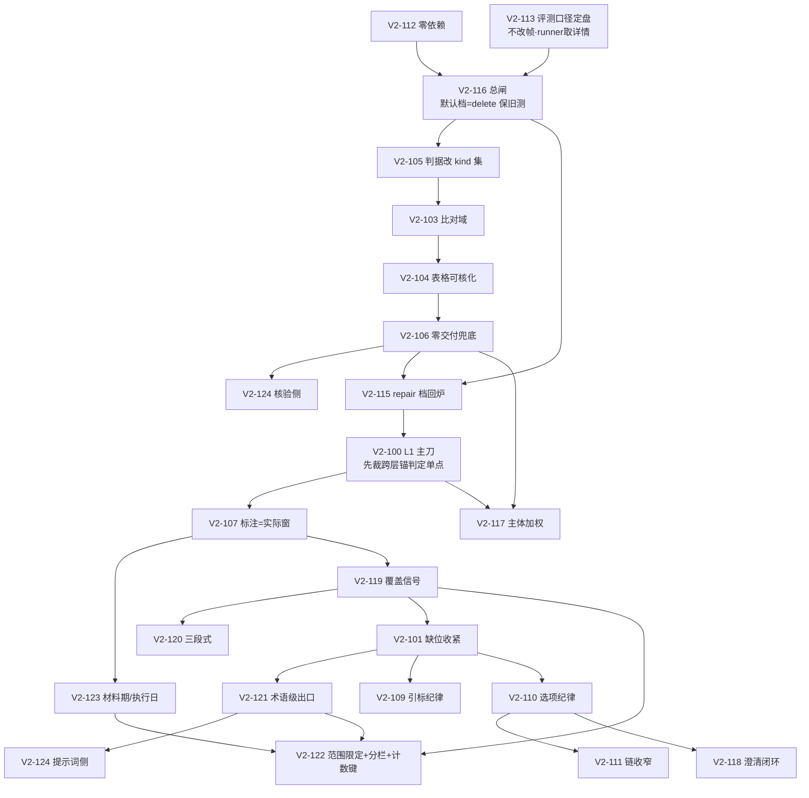

# 统筹 25 票·统一实施方案·评审二：副作用、跨票相互作用与节序

> 只读评审件。取证面＝`tickets/v2/`、`appv2/{retrieval,tools,runtimev2}`、`tests/domains`、`tests/tools`、`docs/runtime-refactor/接手-*.md`。
> 未实点者标「证据不足」；设计自报与实点不符处**双向标注**（含高估与漏报）。对象＝`统筹方案-供给窗口.md`（供）／`统筹方案-作答提示词.md`（作）／`统筹方案-核验澄清评测.md`（核）。
> 计数基线（实点）：`test_v2_verification` **33**、`test_v2_context` **41**（设计自报 35＝**漏计 6**）、`test_v2_retrieval` 12、`test_v2_r1a_send_window` 17、
> `test_v2_answering` 36、`test_v2_prompts` 35、`test_v2_state` 19、`test_v2_bookkeeping` 27、`test_v2_agent_verify` 22、`test_v2_react_loop` 18。

## 一、跨票相互作用矩阵（20 对＋4 补充）

| # | 对 | 影响面（实点） | 冲突 | 建议顺序 |
|---|---|---|---|---|
| 1 | V2-100×V2-89b | `over_budget`（`domain.py:794` 三通道置位）／`test_over_budget_flag_true_when_dropped` | **冲突**：配额挪后新增「配额丢席」族；并入即 EB10 已登记「20/20=true」区分度作废 | 89b 冻结语义→100 另开 `quota_dropped` |
| 2 | V2-100×V2-93 | L3 帽单点 `DEFAULT_MAX_OBSERVATIONS←SEND_BUDGET_CAP`（`materials.py:26`）＋`ANCHOR_SEATS`／`MAX_REPORT_SEATS_PER_SOURCE` | 潜在：L1 复制 L3 常量即第三份帽 | 100 **禁引** L3 常量 |
| 3 | V2-100×V2-90 | L3 `_boundary_hit:248`／`_num_token_hit:227` | **结构性**：R6 禁 runtimev2 直引 retrieval，且 `tools/__init__→handlers→retrieval` 成环（已实点）⇒ L1 需同判据只能重写第三份 | **先裁单点**（供 §六-2）→再落 100 |
| 4 | V2-100×V2-86 | L1 `source_diversify`（同源半额）vs L3 单源上限 6 | 不冲突（两套并存） | 100 不得合并；登记禁第三套 |
| 5 | V2-119×V2-120 | 120 逐字稿「对照下方子问题覆盖表」指代 119 段 | **硬依赖** | 119→120（不可反序） |
| 6 | V2-101×V2-121 | 同改 `ANSWER_DRAFT_CONTRACT`（`constants.py:214-230`） | **字面漂移** | 101→121，后票只许追加 |
| 7 | V2-101×V2-124 | 同改 `ANSWER_DRAFT_CONTRACT`（124 段尾） | 同上 | 101→124 |
| 8 | V2-121×V2-124 | 同段 | 同上 | 121→124 |
| 9 | V2-110×V2-111 | 同改 `CLARIFY_EMISSION_CONTRACT`（族②） | **字面漂移**；110「选项值可原样消费」是 111 措辞前提 | 110→111 |
| 10 | V2-116×V2-115 | `VERIFY_ACTION` 档位单点；115 只在 `repair` 支生效 | **硬依赖** | 116→115 |
| 11–15 | V2-116×{103,104,105,106,124} | 103 比对域／104 记号化／105 `observation_supported`／106 兜底／124 `definition_unsupported` 均插「检测」内 | 不冲突；106 须在处置后仍空时触发 | 116→各票；116→106→115 |
| 16 | V2-122×V2-101 | 同治「库级否定」：101 改合同首句、122 加注记范围指令 | **语义重叠**（双载体同指令，非字面冲突） | 101→122；须裁「唯一收口」 |
| 17 | V2-122×V2-119 | 122 分栏改渲染块形；119 覆盖检测读**渲染窗文本** | **口径漂移** | 119→122；122 后复跑 119 覆盖表口径 |
| 18 | V2-117×V2-93 | 117 在 L3 ⑤ 来源保底**之前**插主体保底席 ⇒ 改 93 定稿席位集合 | **改序冲突**（设计自标 ⚠️） | 93→117；逐席回归 |
| 19 | V2-117×件四(V2-106) | 117 把 `field_attribution_mismatch:614` 从油田名扩到题面主体 | **冲突**：扩面后误拒增多，直喂 106 兜底 | 106→117；复跑 NQ-M4/M8 |
| 20 | V2-113×全批可比性 | `EVAL_FROZEN_DATE`（缺省 2026-08-31）vs EB11 反推 2026-10-08；README §四无断言 | **不可逆**：不先定盘则 EB12/EB11 位移不可归因 | 113 最先 |
| 21 | V2-122×V2-123 | 同改 `render_materials` 块形（块头 vs label 两段） | 同函数改形叠加 | 123→122 |
| 22 | V2-123×V2-107 | 「材料期 vs 执行日」vs「标注＝实际取数窗」 | 口径耦合 | 107→123 |
| 23 | V2-119×V2-113 | 119 新增起草步 payload；113 取 `GET /runs/{id}` 详情 | 互补 | 113→119 |
| 24 | V2-113(作)×V2-113(核) | 作 §二拟「step 帧扩 `payload`」；核 §0.4/§6 明写「**不改帧**，runner 取详情」 | **两设计互斥** | **须 L0 裁**；建议取核方案 |

## 二、将破用例清单（确认 ≈40 例，另 ≈30 例待复核）

### A. `test_v2_verification.py`（33 例）

| 用例 | 原因 | 处置 |
|---|---|---|
| `::test_cited_value_must_be_restated` | V2-105 `CALIBER_KINDS={"ledger"}` **误伤**（fixture `_obs(1,"ledger")`）＋V2-116 observe | 见 §四红线①；fixture kind→`metric` |
| `::test_per_line_check`／`::test_unsupported_deleted_with_verdict_count`／`::test_no_number_assertion_not_auto_pass`／`::test_rewrite_exempt_disclosure_and_group_head`／`::test_numeric_claim_still_deleted`／`::test_identifier_and_date_not_numeric_assertion`／`::test_boundary_single_zero_material_conflict_fullwidth`／`::test_deleted_line_leaves_no_residue`／`::test_unsupported_rewritten_with_notice`／`::test_verification_signal_present`／`::test_rewrite_reason_closed_world`（11 例） | V2-116 默认 `observe` ⇒ 删句断言全线失效（`rewrite_reason` 例 `reasons` 集空） | 逐例 `VERIFY_ACTION=delete` pin（或 conftest 全局默认） |
| `::test_uncited_line_reconciled_with_draft_cited` | **V2-103 扩域**：后半「零已引观察→照删」在窗内含 295/650 ⇒ 保留 | 改判「窗内零命中→照删」＋补正例 |
| `::test_cross_field_line_rejected_without_split_note` | V2-116 observe＋V2-106 兜底文本 | delete pin＋补兜底正证据断言 |
| `::test_attribution_mismatch`／`::test_verdict_all_keys` | V2-117 扩判据面（default 不触发）／V2-115 若加 verdict 键 | 待复核（证据不足） |
| `::test_no_lexicon_or_regex_in_verification` | V2-124 判据若用词表即必破（设计已避） | 保留看守；124 落地前先跑 |

> 设计自报仅 103/104/105/124 相关 4–5 例；**漏报 V2-116 默认档的 10 例级联**。

### B. `test_v2_agent_verify.py`（22 例）— **设计完全漏报**

确认 7 例：`::test_unsupported_claim_rewritten`／`::test_citation_on_unrelated_line_rewritten`／`::test_verify_draft_carrier_zero_overlap_still_rewritten`／
`::test_verify_draft_fragment_zero_overlap_still_rewritten`／`::test_verify_v254_t3_true_no_evidence_still_stamped`／`::test_verify_v269_t1_placeholder_no_evidence_rewritten`／`::test_verify_v269_t4_zero_drift_numeric_support_rewrite_structural_line`。
原因：V2-116 默认 `observe` ⇒ 交付＝草稿逐字（端到端断言 `"86 口井" not in answer` 等）。处置：同批加 `VERIFY_ACTION=delete`——票面 §验收 2 只提「28 例核验测试」，**未覆盖本文件 22 例**。

### C. `test_v2_context.py`（41 例）

| 用例 | 原因 | 处置 |
|---|---|---|
| `::test_material_segment_verbatim_render` | V2-122 分栏块头＋V2-123 label 加「报表期/执行日」⇒ 逐字串必破 | 改判「块头在场＋label 新段」；先出零改证明 |
| `::test_retention_normal_render_unchanged`（:2064-2097 签名形状面） | `render_materials` 恰 3 参断言；122 `source_columns`＋123 `execution_date` | **设计漏报**；签名形状改判并登记 |
| `::test_lineage_lineage_renders_caliber_line_only` | label 拼接同源 ⇒ 加两段即破逐字串 | 同上 |
| `::test_manifest_sources_match_rendered_seats`／`::test_truncation_disclosure_line_verbatim`／`::test_trust_order_stable` | 分栏块头是否改支序／含 `[n]` 形 | 待复核（取决于块头模板） |
| `::test_reports_per_source_cap`／`::test_reports_every_source_gets_a_seat`／`::test_well_anchor_boundary`／`::test_numeric_anchor_no_substring`／`::test_cap_single_source`／`::test_cap_constant_single_point` | 仅当 100 复制 L3 常量／重写边界判定 | 红线看守，非必破 |
| `::test_per_anchor_one_seat`／`::test_anchor_seat_ignores_per_source_cap`／`::test_topic_table_seat_keeps_detail_row`／`::test_topic_section_seat_keeps_original`／`::test_original_over_summary_per_source`／`::test_declaration_not_in_report_seats` | V2-117 在 ⑤ 前插主体保底席 ⇒ 席位集合变 | 待复核（设计未点名） |

### D. `test_v2_retrieval.py`（12 例）

`::test_family_supply`＝**必破**（V2-100 席序重排 ⇒ `{completion:3, monthly:1}` 失效）；处置＝改判「题眼锚先占后族配额余量」。
`::test_supply_window_never_exceeds_budget`／`::test_over_budget_flag_true_when_dropped`／`::test_section_expansion_capped_by_budget_and_upper_bound`＝待复核（配额丢席新族＋语义）。
`::test_window_note_explicit`／`::test_contradiction_same_window`＝**设计高估**：实点为 `in` 子串断言，V2-122 新两段不含「支/召回/送窗/口径」⇒ **不破**。

### E. `test_v2_r1a_send_window.py`（17 例）

必破 6 例：`::test_supply_window_anchor_seat_dropped_when_budget_full`（`anchor_seated==()`＋`over_budget True`）／`::test_supply_window_anchor_seat_within_budget`／
`::test_supply_window_anchor_seat_hits_report_name`／`::..._hits_well_label`／`::..._text_face_unchanged`（后四者钉 `window[-1]=="f-cap-t*"`＝锚追加在尾）／
`::test_retrieve_numeric_core_anchor_hits_report_name_note_visible`（预算吃满侧钉 `anchor_seated==0`）。处置＝全部改判「锚先占、配额被丢」。
待复核 3 例：`::test_supply_window_rowset_group_enters_whole`／`::..._requires_anchor_hit_on_table`／`::test_retrieve_rowset_window_note_truthful`。`::test_supply_window_plain_hinted_path_unchanged`（无锚）保留。

### F. `test_v2_prompts.py`（35 例）

| 用例 | 原因 | 处置 |
|---|---|---|
| `::test_answer_requirements_verbatim` | V2-109 ①替换多一「；」⇒ `count("；")==11` 变 12 | 改判计数＋更新 `_ANSWER_REQUIREMENTS_VERBATIM` |
| `::test_answer_requirements_single_source` | V2-101 置换首句 ⇒ `half="（材料未覆盖所问时：只简短说明未找到与所缺…）。"` 必破 | 改新逐字稿断言 |
| `::test_answer_round_segment_order_no_material` | V2-120 新增 `ANSWER_THREE_STEP_CONTRACT` 置首 ⇒ `lines[0]==_VERB_PIN` 必破 | 改判 `lines[0]` |
| `::test_contract_constant_family_closed_world` | 新增常量（`ANSWER_THREE_STEP_CONTRACT`／`ANSWER_COVERAGE_HEAD|LINE`／`ANSWER_WINDOW_LABEL_CONTRACT`／`ANSWER_PERIOD_CONTRACT`）未入 `_SPEC_FAMILIES` | 逐票同批登记族名单 |
| `::test_contract_constants_no_duplicate_literals`／`::test_answer_round_ban_lines_present`／`::test_system_contract_carriers_split_from_user_dynamic`／`::test_decision_package_four_elements`／`::test_no_lexicon_or_regex_in_prompts` | 新增文本/段位 | 待复核 |
| `::test_contract_constants_business_noun_free` | V2-110 逐字稿含「渤中34-5/34-8/A12H」 | **不破**（实点 fixture 词集＝`K12-3/A7/生产时长/井筒/抽油井`） |

### G. `test_v2_state.py`（19 例）

`::test_field_set_matches_matrix`＝**必破**（断言 S5 矩阵字段数 **56**；112 `well_slot`＋115 `repair_rounds`＋117 `subject_reflection`＋118 `answer_slots/asked_fingerprints`）→ **字段与 S5 矩阵同批提交**。
`::test_constant_families_closed_world`＝**必破**（`INTENT` 恰 11 值；115 加 `INTENT_REPAIR`）→ 改判 12＋登记 `graph.py` 路由表。

### H. `test_v2_bookkeeping.py`（27 例）

`::test_set_intent_single_port_closed_world`＝**必破**（`INTENT` 11 值遍历＋写点扫描；115 新值＋新写点 `orchestration/repair.py`）→ 改判＋写点白名单扩面需裁。
`::test_notice_three_keys_closed_world`／`::test_public_face_signatures`／`::test_step_record_all_fields_and_status`＝**不破**；但 112/115/118 新 notice type 必须同批登记 `transport.NOTICE_TYPES`（29 值）否则运行期拒。

### I. `test_v2_react_loop.py`（18 例）

`::test_consecutive_asks_capped_material_direct_answer`＝**必破**（V2-118 同问指纹＋降级默认 ⇒ 第 2/3 次 ask 不再挂起）→ 改判「只问一次＋默认收口」。
`::test_clarify_target_ambiguity_ask`／`::test_rejection_feedback_redecision_no_repair`＝待复核（`_check_ask` 仍恰四键，`detail` 由 `None`→dict 不破形状）。

### J. `tests/tools/*`

`test_rerun_delivered_answer.py`／`test_rerun_resume.py`（V2-113 runner 断言 `EVAL_FROZEN_DATE` 必填）、`test_contract_coverage.py`／`test_debt_markers.py`（新票号/新 DEBT 未登记即闸红）＝**待复核 3 处**（证据不足）。

## 三、节序不一致清单（设计 ↔ 代码 ↔ 《流程》）

| # | 面 | 差异 | 判定 |
|---|---|---|---|
| 1 | L1 供给 | **设计 §五自报「§一 L1 行 vs §十二 D9 冲突」不成立**：实点 §一 L1 行已写「**题眼锚/表格/原文候选先占预算**→族配额→来源多样→行集→节内展开（顺序以 §十二 D9 为准）」 | 设计陈旧自报；**无需改写 §一**，100 按 §一 施工即合 D9 |
| 2 | L1 供给 | **自报「§四 缺『声明支出池』括注」不成立**：实点 §四 2) 已写「不进检索族候选（D4——这是**过滤**，不是独立席位池），走 note 通道」 | 仅「支出池」一词未出现；建议 spec 层统一术语，不动《流程》 |
| 3 | L1 供给 | 设计 §二 100 伪代码**丢了「余量补给」步**（`domain.py:766-772`）与 `source_diversify` 归位；《流程》§一亦未列余量 | 实施须显式保留余量步，否则窗不满预算 |
| 4 | L1 供给 | 去重粒度「来源级→片段级」但**未给片段级上界**（同源多锚可重复占席） | 缺上界＝预算被单源吃干，与 V2-86 单源上限冲突；须补 |
| 5 | L3 渲染 | 实点 `_select_seats`＝⓪声明过滤→①题眼→②原文→③表格→④锚共现→⑤来源保底→⑥轮转→⑦上限；《流程》§四 1)–5) 同序 | ✅ 一致 |
| 6 | L3 渲染 | 设计 §五 row6：117 在 ⑤ **之前**插主体保底席 | ⚠️ 增量改序（自标需 L0）——《流程》§四无此节 |
| 7 | 作答调用 | 实点 `answer_system_contract`＝`_VERB_PIN→【答案要求】→白话表→汇总→族⑤b→起草`；`_draft`＝`assemble_answer_prompt＋materials_text＋engine_notes_block`；设计 §三 9 段表同序 | ✅ 一致（119 插点在清单与材料之间＝与代码一致） |
| 8 | 作答调用 | 设计 §三 row7 把「【作答前三步】」列为 system 首段 | ✅ 与拼接序一致；仅 `::test_answer_round_segment_order_no_material` 需改判 |
| 9 | 核验 | 实点 `_verify`＝块剥除→`_verify_lines`（检测即删同拍）→矛盾分列→归属审→行集对账→signals→draft/verdict；设计 §3.1「现行」一致 | ✅ |
| 10 | 核验 | 设计 §3.1「目标」分离「检测/处置」，但实点 `_verify_lines` 同拍；且 **V2-106 件四拒收在 `_verify_lines` 内（`:444-449`）**，设计 §2.6 却写「在 `_verify` 收口处加兜底闸」 | **不一致**：兜底须落 `_verify_lines` 返回后、`text="\n".join(out_lines)`（`:235`）之前，否则进不了 `state.draft` |
| 11 | 核验 | 115 `INTENT_REPAIR` 须登记 `state/constants.INTENT`＋`graph.py:100-149`；实点 `NODE_VERIFY` 仅 `{answer,end}` | 设计已声明；需加边（`test_four_phase_routing_topology` 用 `<=` 故不破） |
| 12 | 澄清 | 实点 `clarify()`＝`_consume_resume→_open_round→call_model→append→_dispatch`；设计 §3.2「现行」一致 | ✅ |
| 13 | 澄清 | 118「降级默认不占 `ask_cap`」未给落点；实点计数点 `_ask_count:831-845` | 须确认降级路径不增计数 |
| 14 | 跨层 | L1 `budget` 缺省 6（逐子问题）vs L3 cap＝`SEND_BUDGET_CAP` 24 | 两值两源，设计 §六-7 已列需裁，**未解** |

## 四、副作用与缓解表（逐票）

| 票 | 会影响谁 | 不可逆风险 | 缓解 |
|---|---|---|---|
| V2-100 | `retrieval/domain.py` 全窗构成；`test_v2_retrieval`(1+)／`test_v2_r1a_send_window`(6+)／`test_v2_context` 席位族；`specs/retrieval.md` 行为 2 | ① `over_budget` 若并污，EB10 已发布判分册区分度**不可回溯**；② 跨层锚判定若落第三份副本，V2-90 已钉 `W-11≠W-111`／`22≠2200` 回退 | 先裁单点（供 §六-2）；`over_budget` 冻结＋另开 `quota_dropped`；每票独立全量回归 |
| V2-107 | `handlers._rows_observations` 血缘 payload 键闭世界；`verification/rules.py` 新纯函数；`specs/{query,verification,prompts}.md` | 新增核验机检**跨组越界**（核组设计未覆盖本票） | 与 115 划界（只标红不删句）；核验侧函数归核组评审 |
| V2-112 | `tools/precondition.py:93,623`；`QueryPlan`；`handlers.py:185-205` plan schema；`test_v2_tools.py::test_descriptors_readonly`（plan_props 恰 10 键） | `well_slot` 入 plan schema ⇒ 该测必破；新 notice type 未登记 ⇒ 运行期拒 | 槽位只落 `QueryPlan`（不进 plan_draft schema）或同步改判；notice type 同批登记闭世界 |
| V2-117 | `_select_seats` ⑤ 前；`rules.field_attribution_mismatch`；`test_v2_context` 席位族；`test_v2_verification` 件四 | 席位集合变＋归属面扩 ⇒ 与 93/106 判据叠加 | 严格串行；跨主体对照正例（C-正3／D-诱14）零回退断言 |
| V2-119 | `answering/core.py::_draft` 上下文段＋payload；`specs/answering.md` | **两设计给出不同常量名**（供 `COVERAGE_LINE` vs 作 `ANSWER_COVERAGE_HEAD/LINE`）⇒ 单点破裂 | 先统一常量名（取作方案）；只检测不改材料 |
| V2-120 | `prompts/answer_round.py:86-102`；`test_v2_prompts` 段序族 | 段首件位移 ⇒ 既有段序断言全批改判 | 一票一提交；新常量同批入族名单 |
| V2-101/121/124(作) | 同 `ANSWER_DRAFT_CONTRACT`（族⑤） | 三票并发改写 ⇒ 字面漂移、单点破裂（V2-80 系列同型病灶） | 101→121→124 串行；后票只许追加 |
| V2-109 | `ANSWER_REQUIREMENTS`（族⑥）①；`::test_answer_requirements_verbatim` | 「；」计数断言破；误伤定性句放行（V2-94） | 与 101 同批回归（同答案规章段）；改判计数 |
| V2-110/111 | 同 `CLARIFY_EMISSION_CONTRACT`（族②） | 字面漂移；111 窄口在澄清相位**无程序事实可判**（语义自证） | 110→111 串行；111 窄口须 L0 裁可执行性 |
| V2-122 | `retrieval/domain.build_window_note`；`context/render_materials` 块形；`test_v2_context` 逐字族；`specs/{retrieval,context}.md` | 分栏＝**输出序改形**；披露行／三机检字段／`selected_reason` 逐字红线 | 先出「逐字零改证明」；只插块头行；分栏后复跑 119 覆盖表口径 |
| V2-123 | `render_materials` 签名＋label；`LoopDeps`；`specs/context.md` 入参纪律 | label 两段破逐字断言；`execution_date` 注入是否破「时间量不经本块」 | 签名形状改判同批登记；执行日由编排注入（非时钟接触）须 L0 确认 |
| V2-116 | `verification/core.py` 三删句点；`VERIFY_ACTION` env；**55 例既有测试**（33＋22） | 默认 `observe` ⇒ 全批既有删句断言同批红；直接改判则**掩盖旧行为回归** | 默认档设 `delete`（旧行为）或加 conftest 全局 pin；observe 档另立新测 |
| V2-115 | 编排侧新节点；`state.INTENT` 闭世界；`graph` 路由；R8 零 LLM 红线 | 照票面落 verification 即破 R8＋`::no_model_call_in_verification`＋`::deterministic_repeatable`（AST 机检） | 取编排侧形；`INTENT_REPAIR`＋路由表＋S5 矩阵同批 |
| V2-103 | `verification/core.py:427-430,465-478` 比对域 | 扩到全窗 ⇒ 无据断言可借窗内数字蒙混 | 保留记号全等；误放行面登记给 117 主体加权 |
| V2-104 | `rules.number_tokens` 或 `context/materials.py` 回填 | 案 A 动 context ⇒ 破 V2-93 席位/渲染用例；案 B 破判据单点 | A/B 择一须 L0；案 A 优先 |
| V2-105 | `rules.observation_supported`＋`number_tokens` | **红线①**：设计 `CALIBER_KINDS={"ledger"}` 取的是**信任级值**，实点台账卡 `locator.kind ∈ {metric,term,object,relation,family_annotation}`（`_KIND_TRUST:48-59`）；生产不命中、测试 fixture 全命中 ⇒ **判据错位＋~15 例误放行**，不可逆 | 判据改 `{metric,term,object,relation,family_annotation}`；与 124 定义等式判据同批评审 |
| V2-106 | `verification/core.py` 件四；`rules.field_attribution_mismatch` | 兜底文本进正文 vs 增补面（决定 `runs.answer` 是否非空） | L0 裁；不放松件四判据本身 |
| V2-118 | `clarification/core.py`＋`orchestration/runtime.py`；ask 帧 `detail`；`state` 新字段 | 顶层 `slot` 形须改 `transport/frames.py`（帧闭世界）；新字段破 S5 矩阵 | 取 `detail.slot` 形（零帧闭世界变更）；字段同批入矩阵 |
| V2-113 | `eval/suite-147/runner.py`／README；`specs/transport.md` | **红线②**：供/作拟扩 step 帧 `payload` ⇒ 帧闭世界对外可见，撤回成本高；冻结日取值定错则 EB12 全批不可比 | 取核方案（**不改帧**，runner 取详情）；单一冻结日入 README＋env 断言 |
| V2-124(核) | `rules` 新 `definition_unsupported`；`::no_lexicon_or_regex_in_verification` | 推断词表入核验即破零词表闸 | 推断归提示词；`RewriteRecord.reason` **恒两值**（红线④） |

**红线复核**：① `over_budget`＝仅三通道追加席被丢（`domain.py:794`）—100 不得并污 ✅ 已识别；② 帧闭世界（`transport/frames.py` 无 step 校验器，但 `specs/transport.md` 定形）—两设计互斥 ⚠️ 未裁；
③ 披露行／三机检字段／`selected_reason` 逐字（`test_truncation_disclosure_line_verbatim`／`test_manifest_material_fields_and_reason`／`test_manifest_sources_match_rendered_seats`）—122/123 触碰 ⚠️；
④ `RewriteRecord.reason` 两值（`verification/constants.py:33-35`）—115/124 均声明不变 ✅；⑤ state 字段矩阵 56—4 票新增字段，**须与 S5 矩阵同批** ⚠️。

## 五、回归样本覆盖表（EB11 题号，已实点 `eval/suite-147/manifest*.jsonl` 全在册）

| 票 | 设计给样本 | 必评集覆盖 | 缺 | 补齐建议 |
|---|---|---|---|---|
| V2-100 | B-正6／NQ-C9／B-正2／C-反1／C-正4／NQ-C6 | B-正2/B-正6 ✅ | **A-正6**（D9 主证据：`anchors=[W-111,井别,投产,完井]`、`anchor_seated=0`）；数-闸2/3 | 加 A-正6、Q41 |
| V2-107 | 数-闸2／数-闸3／数-闸1／Q39 | 数-闸2/3 ✅ | **Q10／Q14**（EB11 方案预期收益列，设计行未列） | 加 Q10、Q14 |
| V2-112 | Q40／Q49／Q47／Q48／Q10／Q14／Q24 | Q40、Q10/Q14 ✅ | — | 保留 |
| V2-117 | NQ-M8／NQ-M4／A-正6／C-正3／D-诱14／Q13 | NQ-M4/M8、A-正6 ✅ | — | 保留 |
| V2-119 | B-正6／NQ-M8／Q11／Q26／Q31／Q35／Q41 | NQ-M8 ✅ | 「材料充分题零误报」**无具名题** | 补 Q24／Q47 为对照 |
| V2-122 | A-正6／Q41／A-正2／Q26／Q31／NQ-M8 | A-正6 ✅ | — | 保留 |
| V2-123 | Q07／NQ-M8／NQ-M1／Q13 | — | — | 保留 |
| V2-120 | 零支撑题先 explore（B-正6 形）／充分题不 explore | B-正6 隐含 ✅ | **未具名** | 补 B-正6＋Q24 |
| V2-101 | A-正6／D-诱13／Q43 | A-正6 ✅ | — | 保留 |
| V2-109 | 「含数值句带标率↑（10 帧 cited=[] 对照）」 | — | **无题号** | 补 数-排1、D-诱1 |
| V2-110 | Q05／Q39／B-正2／B-正6／Q16 | Q16、B-正2/B-正6 ✅ | — | 保留 |
| V2-111 | Q11／Q26／Q31／Q35／Q41 | — | — | 保留 |
| V2-124 | Q45／NQ-M1 | Q45 ✅ | Q42／Q47／Q48（《清单》预期覆盖列） | 补 Q47、Q48 |
| V2-116 | 数-排1／D-诱1 | 数-排1、D-诱1 ✅ | **Q27**、NQ-M4 | 补 Q27、NQ-M4 |
| V2-115 | 数-排1／D-诱1 | ✅ | — | 保留 |
| V2-103 | 数-排1 | 数-排1 ✅ | **SYS-1／数-察2／Q33**（EB11 方案预期收益列） | 补 3 题 |
| V2-104 | D-诱1 | D-诱1 ✅ | 「32 题表格题面」无具名题 | 补 数-排1（表格行面） |
| V2-105 | Q27 | Q27 ✅ | **无反向对照**（真编造数字行仍须删） | 补 D-诱1 |
| V2-106 | NQ-M4／NQ-M8 | ✅ | — | 保留 |
| V2-118 | Q16 | Q16 ✅ | 22 题 29 次拒绝面**无具名题** | 补 Q39／B-正2 |
| V2-113 | 对照 `EB11-删句原句.jsonl`（147 行／52 题／134 条） | — | 无题号级样本 | 补 Q10/Q14/Q16（设计 §四已列） |

## 六、缺票面清单（实点 `tickets/v2/`）

**设计覆盖但无票面文件（14 票）**：`V2-100`／`101`／`102`／`103`／`104`／`105`／`106`／`107`／`108`／`109`／`110`／`111`／`112`／`113`。
（V2-114 已并入 `V2-122-材料范围限定与计数如实.md` 票面标题「并入原 V2-114」⇒ 不算缺；V2-102 吸收进 119/120；V2-108 吸收进 V2-118。）

**三设计缺票面申报不全**：供 §首申报 100/107/112 ✅；核 §首申报 103/104/105/106/113 ✅；作 **未申报** 101/109/110/111 缺票面（而其 §二 逐票给「逐字稿」，无票面载体）❌ **漏报 4 票**；两设计均未点出 108 无独立票面。

**按 AGENTS.md 6b 的后果**：缺票面 ⇒ ① 无 shape 闸承载位（「逐字稿载体」无票面附节/引用块），意图级描述即 FAIL，零上下文子代理将自行设计；
② 「一票一分支一提交」无验收对象可勾（票面对象全勾＝合并前提）；③ 设计件不能替代票面（真源纪律：设计件只读取证）。
**结论：14 票须先补票面再开工**；101/109/110/111 的逐字稿须从设计件转写为票面引用块。

## 七、总顺序建议＋硬依赖图

| 波 | 票 | 串/并 | 硬依赖理由 |
|---|---|---|---|
| 0 | **V2-113** ∥ **V2-112** | 并 | 113＝EB12 可比性前提；112 零依赖（只换 token 单点＋加槽位/注记） |
| 1 | **V2-116** | 串 | 总闸；**默认档须设 `delete` 或 conftest 全局 pin**，否则 55 例同批红 |
| 2 | **V2-105 → V2-103 → V2-104 → V2-106 → V2-124(核)** | 串 | 核验精度逐票独立回归；105 判据错位须先改对 |
| 3 | **V2-115** | 串 | 依赖 116（repair 档）＋106（兜底）＋`INTENT_REPAIR` 登记 |
| 4 | **V2-100** | 串（单独一波） | 主刀；须先裁跨层锚判定单点，否则落第三份副本回退 V2-90 |
| 5 | **V2-107 → V2-123** ∥ **V2-117** | 串＋并 | 123 需 107 时间语义；117 需 100 席序＋106 件四 |
| 6 | **V2-119 → V2-120** | 串（硬） | 120 逐字稿指代 119 段；反序＝合同悬空 |
| 7 | **V2-101 → V2-121 → V2-124(作)** ∥ **V2-109** | 串＋并 | 三票同改族⑤；109 改族⑥，须在 101 后（同答案规章段） |
| 8 | **V2-110 → V2-111** | 串 | 同改族②；110 措辞是 111 前提 |
| 9 | **V2-122** | 串（最后） | 依赖 123 材料头＋119 覆盖段＋101 范围口径；分栏改渲染块形＝一次性全量渲染回归 |
| 10 | **V2-118** | 可并 | 澄清独立于核验档位；建议在 110 后（避免重复改族②） |

**硬依赖边**：`119→120`｜`123→122`｜`100→117`｜`106→115`｜`116→115`｜`116→{103,104,105,106,124核}`｜`101→{121,124作,109,122}`｜`121→122`｜`110→111`｜`107→123`｜`113→全批`。

**与《清单》§五波次三处偏离（须 L0 裁）**：① 《清单》波 1 作 `100→119→120`，本评审作 `119→120` 在 100 之后（100 是 119 的窗面前提）；
② 《清单》波 3 核验在 117/121/122/123 之后，本评审把核验止血提到波 2（零交付/误删先止血，且 116 是观察档前提）；③ 《清单》未给 116 档位默认值，本评审要求默认 `delete`。

---

### 最关键 3 条

1. **V2-105 判据取错值域（`CALIBER_KINDS={"ledger"}`）＝设计缺陷且不可逆**：`ledger` 是**信任级**（`_KIND_TRUST` 的值），而生产台账卡 `locator.kind ∈ {metric,term,object,relation,family_annotation}`。
   照设计落地则生产不命中、测试 fixture 全命中，造成「真编造仍放行＋~15 例既有核验测试误放行」双错。**必须先改判据值域再开工**。
2. **V2-116 默认档 `observe` 会一次打红 55 例既有测试**（`test_v2_verification` 33＋`test_v2_agent_verify` 22，后者设计完全漏报）。
   缓解＝默认档设 `delete`（保留旧行为）＋conftest 全局 pin，`observe` 另立新测；否则只能整批改判，**旧行为回归被掩盖**。
3. **V2-113 两设计互斥（扩帧 vs 取详情）且它决定 EB12 全批可比性**：作 §二拟扩 step 帧 `payload`（动帧闭世界），核 §0.4/§6 明写不改帧、runner 取 `GET /runs/{id}` 详情。
   **须 L0 裁**；建议取核方案，并同步把单一冻结日写入 `suite-147/README` §四＋runner env 断言——否则 EB12 与 EB11 的 ✅/⚠️/❌ 位移不可归因（此风险不可逆）。

> 另需 L0 裁：① 14 票补票面（含作设计漏报的 101/109/110/111）；② V2-119 常量名两设计不一致；③ 122 分栏与 117 主体席是否算「改形」（《流程》§四钉「输出序零改」）；
> ④ 跨层锚判定单点落点（供 §六-2 三案）；⑤ 106 兜底文本进正文 vs 增补面。
