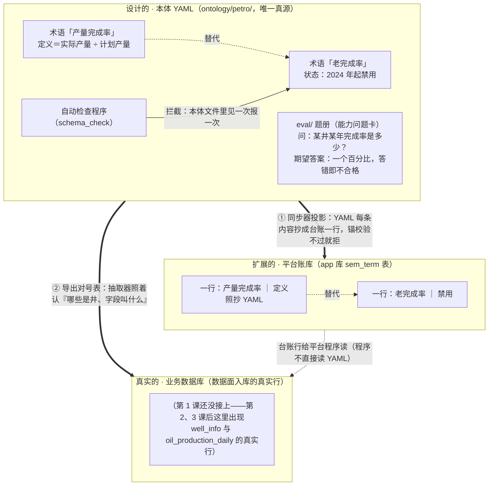

# 本体图解课·实体演变图（一张图随课长）

> 配套《Ontology 图解课 25 课》白话串讲用。**不分课**：下面这张图是"讲到目前为止"的完整状态，每讲一课就直接在图上继续长，底部「演变记录」补一行。
>
> 画图规矩：①层内必须框＋带字连线成结构，不许罗列散点；②**三个仓必须画系统里真实存在的东西**，同一份内容在几个仓里各长什么样、靠什么对应，是这张图的重点。
>
> 三个仓（系统真实位置）：
>
> - **设计的 · 本体 YAML**：`ontology/petro/` 的模式文件。唯一真源——只写种类、词义、规矩，不装真实数据。
> - **扩展的 · 平台账库**：app 数据库里的 `sem_*` 表。同步器把 YAML 的每条内容抄成一行台账（锚校验不过就拒抄）；对号表（`entity_types.json` 等）也从 YAML 导出。
> - **真实的 · 业务数据库**：数据面入库的真实数据（`well_info`、`oil_production_daily`……的行）。
>
> 一句话记住关系：**YAML 是设计图，台账和对号表是从它派生的扩展物，业务数据是真实世界；真实数据按对号表被认领、按 YAML 的规矩被读。**
>
> 渲染：GitHub / Typora / Obsidian / VSCode（Markdown 预览）直接出图。

## 当前这张图

## 演变记录

- **第 1 课**：设计的仓里出现三样——术语「产量完成率」（定义＝实际÷计划）、术语「老完成率」（2024 起禁用，与前者是替代关系）、eval/ 题册（能力问题卡：问题＋输入＋期望答案）；自动检查程序—拦截→老完成率。扩展的仓里，同步器把两条术语抄成 sem_term 表的两行，替代关系跟着抄。真实的仓还空着。
- **第 1 课返工（按系统真实三仓重画）**：原来的"本体层/实例层/数据库层"改成系统里真实存在的三仓——本体 YAML、平台台账（sem_*）、业务数据库；两条派生箭头写实了名字：①同步器投影、②导出对号表。

以后每讲一课：图上加框加线，这里补一行。
