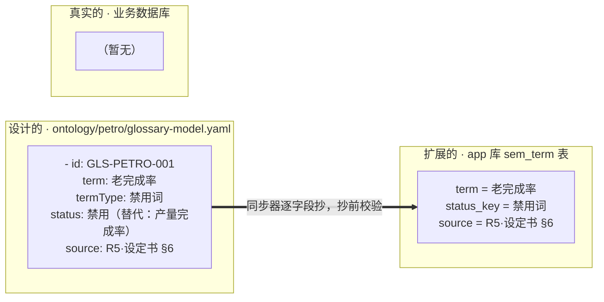

# 本体图解课·实体演变图（一张图随课长）

> 配套《Ontology 图解课 25 课》白话串讲用。**不分课**：下面这张图是"讲到目前为止"的完整状态，每讲一课直接在图上继续长，底部「演变记录」补一行。
>
> 画图规矩：①框里只放**数据本身**——真实文件里的真实字段值、表里的真实行，讲解一律写在图外文字；②框和框用带字的线连，不许罗列散点；③三个仓是系统真实位置：**设计的**（`ontology/petro/` 的 YAML）、**扩展的**（app 库 `sem_*` 台账表）、**真实的**（业务数据库）。
>
> 渲染：GitHub / Typora / Obsidian / VSCode（Markdown 预览）直接出图。

## 当前这张图

图外两句话：

1. YAML 里这条术语是唯一真源；台账那一行是同步器从它逐字段抄出来的，程序只读台账、不读 YAML。
2. 第 1 课的产物是能力问题卡（一个问题＋给定输入＋期望答案）；它在项目里的对应物（eval/ 题册）到第 19 课才进图。

## 演变记录

- **第 1 课**：设计仓进第一条真实数据——GLS-PETRO-001（老完成率，禁用词，替代＝产量完成率）；扩展仓同步进台账一行（term/status_key/source 三列真实值）；真实仓为空。
- **第 1 课返工×2**：①箭头方向修正（拦截关系主语是检查程序）＋补"表照本体造"；②三仓按系统真实位置重画（本体 YAML／平台台账／业务数据库）；③图内只留数据本身，讲解全部移到图外。
- **第 1 课返工×3（删课外内容）**：删掉"验收仓"和 Z-16 题册——题册是第 19 课（本体需求工程）的内容，第 1 课只讲能力问题卡本身；图回到三仓。

以后每讲一课：三仓各进真实数据，这里补一行。
