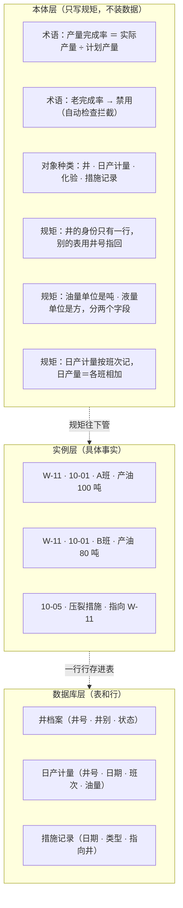

# 本体图解课·实体演变图（一张图随课长）

> 配套《Ontology 图解课 25 课》白话串讲用。**不分课**：下面这张图是"讲到目前为止"的完整状态，每讲一课就直接在图上继续长，底部「演变记录」补一行。
>
> 三层永远分开，不许混：
>
> - **本体层**：只写种类、词义、规矩，不装任何一口井的具体数据（项目里 = `ontology/` 目录的 YAML 文件）
> - **实例层**：具体的事实，比如"W-11 井 10 月 1 日 A 班产油 100 吨"
> - **数据库层**：真正存数据的地方，一张张表、一行行记录（项目里 = PostgreSQL）
>
> 一句话记住关系：**本体层管规矩，数据库层装事实；表里的每一行，就是一条实例。**
>
> 渲染：GitHub / Typora / Obsidian / VSCode（Markdown 预览）直接出图。

## 当前这张图

## 演变记录

- **第 1 课**：本体层加术语表——产量完成率的定义、老完成率标禁用（自动检查拦截旧词）。其余两层为空。
- **第 2 课**：本体层加对象种类"井"和"身份只有一行"的规矩；数据库层出现井档案表。名单/分类只是指向井，不复制井；井的状态是身上的字段，会变但身份不变。
- **第 3 课**：本体层加"数字带单位（吨/方分字段）""日产计量按班次记、日产量＝各班相加"的规矩；数据库层加日产计量表、措施记录表（一次发生一条记录，指向井不复制井）；实例层出现第一批事实行。

以后每讲一课：图上加节点，这里补一行。
