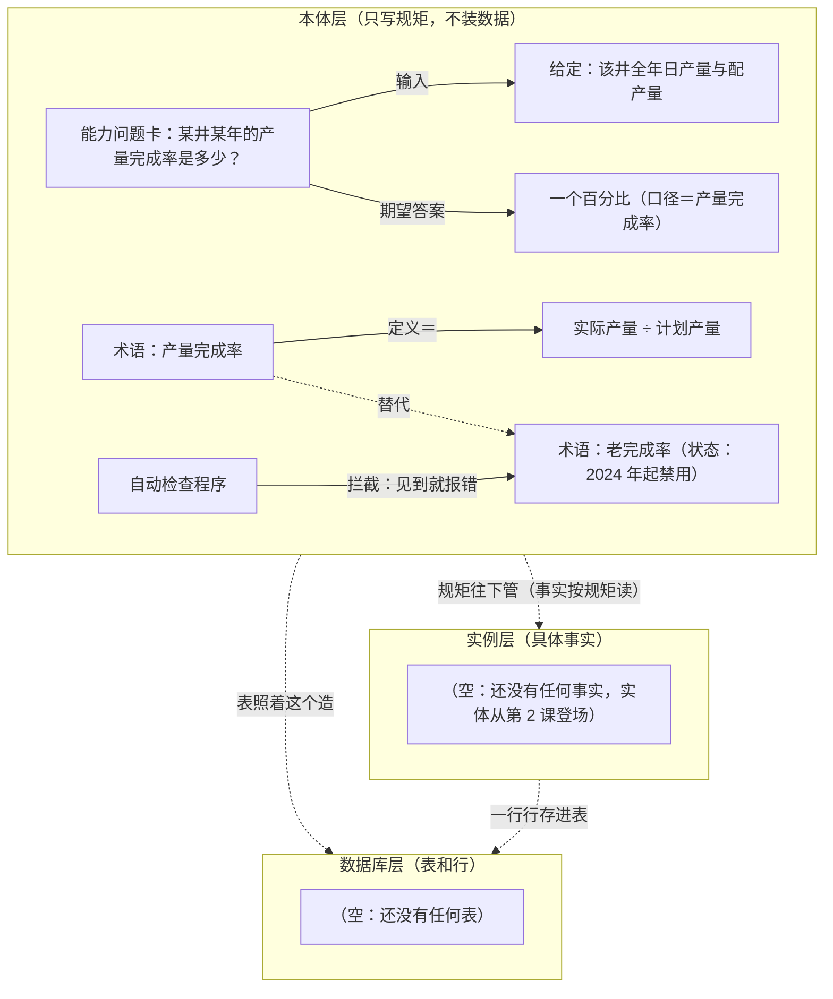

# 本体图解课·实体演变图（一张图随课长）

> 配套《Ontology 图解课 25 课》白话串讲用。**不分课**：下面这张图是"讲到目前为止"的完整状态，每讲一课就直接在图上继续长，底部「演变记录」补一行。
>
> 画图规矩：**层内必须画出结构——框和框用带字的线连起来，不许罗列散点。**每条线读出来是一句话（如"老完成率 —禁用→ 被自动检查程序拦截"）。
>
> 三层永远分开，不许混：
>
> - **本体层**：只写种类、词义、规矩，不装任何一口井的具体数据（项目里 = `ontology/` 目录的 YAML 文件）
> - **实例层**：具体的事实，比如"W-11 井 10 月 1 日 A 班产油 100 吨"
> - **数据库层**：真正存数据的地方，一张张表、一行行记录（项目里 = PostgreSQL）
>
> 一句话记住关系：**本体层管规矩，数据库层装事实；表里的每一行，就是一条实例。**
>
> 渲染：GitHub / Typora / Obsidian / VSCode（Markdown 预览）直接出图。

## 当前这张图

## 演变记录

- **第 1 课**：本体层出现两组连好的结构——①能力问题卡：问题→输入→期望答案（先出题再建模，题目用不到的不建）；②术语结构：产量完成率—定义→实际÷计划；产量完成率—替代→老完成率；自动检查程序—拦截→老完成率（"禁用"是老完成率身上的状态，写在框里，不做箭头）。
- **第 1 课返工（箭头核对）**：①修正方向反了的箭头——原画"老完成率—禁用→检查程序"，实际是"检查程序—拦截→老完成率"；②"禁用"从箭头改成框内状态；③补漏——本体层—表照着这个造→数据库层（表结构按本体来，项目里导出的对号表就是干这个的）。

以后每讲一课：图上加框加线，这里补一行。
